# PULLWAVE — video downloader and anime player for Linux and Windows

Pullwave is a desktop app with a cyberpunk look (and light and dark themes too) for downloading videos and for keeping and watching anime. It has two parts, side by side:

- **Video downloader:** download videos and audio from the sites [yt-dlp](https://github.com/yt-dlp/yt-dlp) supports, with a queue, a history and live-stream recording.
- **Anime:** search, download, a library of your own and a player, built on [ani-cli](https://github.com/pystardust/ani-cli). On Linux and on Windows 10 (version 1903) or newer.

There is nothing else to install: everything the app needs comes with it.

> **Disclaimer:** every download made with this program is **at the user's own risk and responsibility**. The authors and contributors are not responsible for what is downloaded or for how it is used. You must only download content you have the right to download. See [DISCLAIMER.md](DISCLAIMER.md).

| Cyberpunk | Dark | Light |
|---|---|---|
| 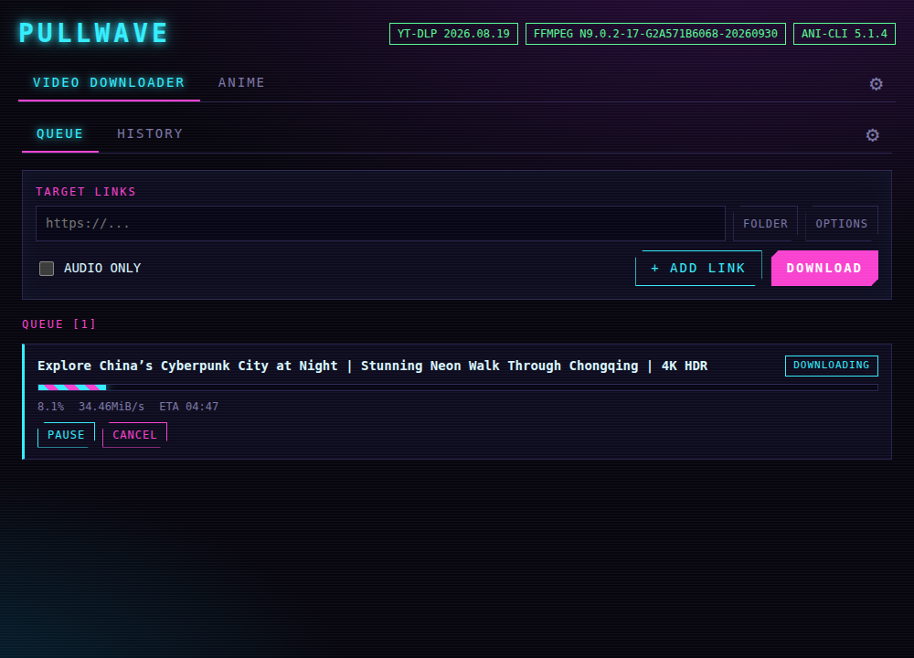 | 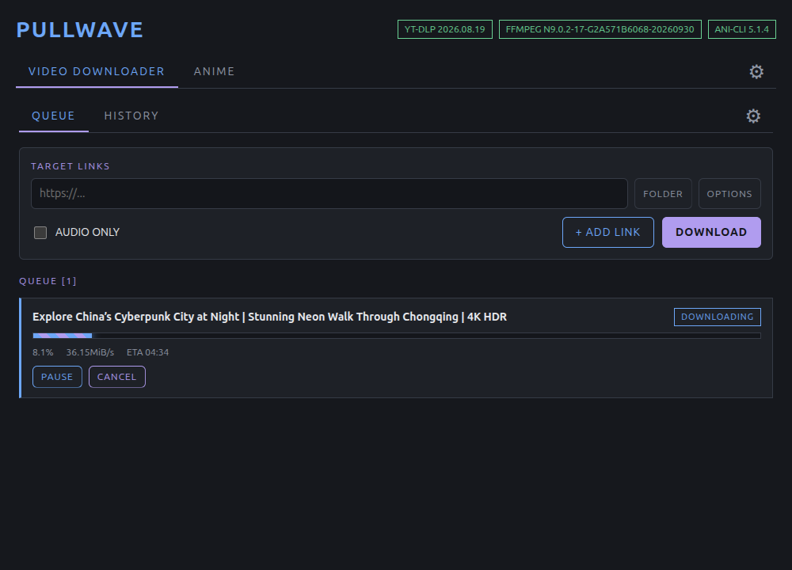 | 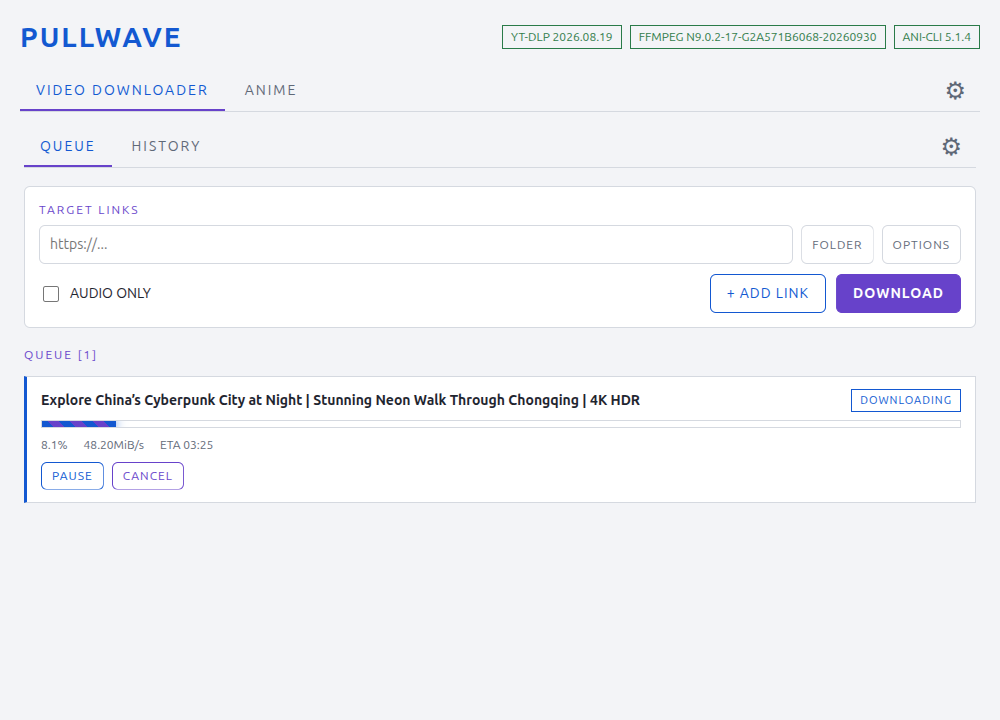 |

## Highlights
- Choose the quality, the format and the subtitles of each download, or download only the audio.
- Record **live streams**, wait for scheduled ones and keep the file even if the stream drops.
- An **anime library** of your own, with series and seasons, where you stopped watching and subtitles in every language the source offers.
- A **player** inside the app, or watch an episode **without downloading** it.
- **Subtitles made for you:** translate a subtitle into another language, or create one from the audio of an episode that has none, with your own account at OpenAI, Claude, Gemini and others.
- **Manga** from the sources of the Mihon/Tachiyomi extensions: search them all at once, keep a library of cards, read in the app and download as CBZ.
- The whole app in **English, Português, Español, 中文 and 日本語**.
- Updates itself, and downloads and updates its video and anime tools from inside the app (the package stays small).

## Install
Download the file for your system from the [Releases page](https://github.com/monothread/pullwave/releases/latest).

| System | File |
|---|---|
| Windows 10/11 (64-bit) | `pullwave-x.y.z-setup.exe` |
| Linux | `pullwave-x.y.z.AppImage` (portable, installs nothing) |

**Windows** — run the setup file. It installs for your user only and creates the shortcuts. The installer is not code-signed, so Windows SmartScreen may show "Windows protected your PC": choose *More info* → *Run anyway*.

**Linux** — allow the AppImage to run, then open it:
```bash
chmod +x pullwave-x.y.z.AppImage
./pullwave-x.y.z.AppImage
```
Ubuntu 22.04 and newer need FUSE 2 for AppImages (`sudo apt install libfuse2`, or `libfuse2t64` on Ubuntu 24.04). If it does not open on Ubuntu 24.04, run it with `--no-sandbox`.

**The first time it opens** the app downloads the programs it runs (yt-dlp, deno and ffmpeg for the video downloader, plus ani-cli, busybox and curl for the anime section; about 200 MB in all) into its own folder, so the package stays small and none of your programs is touched. The header shows how it goes, and the video downloader and the anime section wait for their programs with a bar for each one; if one fails (no connection, for example) it says why and has **TRY AGAIN**, and what is ready is kept. You need a connection that first time only; the same boxes **Status of the programs** in the settings (ffmpeg in the global ones, yt-dlp in those of the video downloader, ani-cli in those of the anime) keep them up to date afterwards.

Once installed, the app looks for new versions by itself (the ⚙ of the top bar, APP UPDATES): one click downloads the update and another restarts into it.

## Getting around
The top bar has **VIDEO DOWNLOADER**, **ANIME**, **MANGA** and a ⚙ for the settings of the whole app. Each part has its own bar and its own ⚙:

| Part | Screens |
|---|---|
| VIDEO DOWNLOADER | QUEUE · HISTORY · ⚙ |
| ANIME | SCHEDULE · UPDATES · SEARCH · LIBRARY · HISTORY · ⚙ (and a DOWNLOADS button) |
| MANGA | BROWSE · LIBRARY · EXTENSIONS · ⚙ (and a DOWNLOADS button) |

The back and forward buttons of the mouse take you through the screens you have been to.

## Video downloader


### Queue
- Paste a link, or several: **+ ADD LINK** gives you one field per link. **FOLDER** sends that download to another folder, and **OPTIONS** changes the quality, the format and the live-stream behavior for that download only.
- Every download shows its progress, speed and time left, and can be paused, resumed, cancelled or retried. Up to three downloads run at the same time, the others wait their turn. When one finishes you get a notice, and it moves to the history.
- **PAUSE** stops a download and keeps what was already downloaded; **RESUME** goes on from there, and a paused download leaves its place in the queue to the next one. A live recording cannot be paused (STOP & SAVE ends it). A paused download is still there, paused, when you open the app again, and RESUME goes on from its partial files. Closing the app while downloads are running cancels them and deletes their unfinished files (paused downloads are kept, with theirs); the app asks before it does.
- If something goes wrong, a clear message explains what happened, with the details one click away.

  

- Failed or cancelled downloads clean up after themselves; live recordings are always kept.

### History


Every download, finished or failed, with the time and a button to show the file.

### Quality, audio and subtitles
- The best video and audio available, up to the maximum resolution you choose, as mp4, mkv or webm.
- **Audio only** as mp3, m4a or opus.
- Playlists, and subtitles in the languages you choose, including YouTube's automatic captions. Subtitles can be embedded in the video, leaving a single file.
- A limit on the length of file names, and an option to keep them plain ASCII.

### Videos that need a login
Use the cookies of your browser for age-restricted, private or members-only videos. The browsers installed on your computer, and their profiles, are found automatically; **RESCAN BROWSERS** looks again after you install one.

### Live streams
- Record a live from the start (when the broadcaster allows it), or wait for a scheduled live to begin.
- **STOP & SAVE** ends the recording and keeps the file. The card shows how long it has been recording and how big the file is.
- If the stream drops, the app keeps looking for it for a few seconds. If it comes back, the recording goes on in a new file of the same download.

### Settings of the video downloader (⚙)


Where downloads are saved and how files are named, quality and format, playlists and subtitles, live streams, browser cookies, and advanced options such as a speed limit or using your own yt-dlp and ffmpeg. The **Status of the programs** box shows yt-dlp and deno (which it runs the scripts of some sites with): whether they are installed, their version, the latest one (**CHECK FOR NEW VERSIONS**) and **UPDATE TO** it, which installs the release beside the one that works, checks it (the list of checksums of yt-dlp has to be signed by the yt-dlp project, with the key that comes with the app) and only then uses it. **USE THE VERSION OF THE APP** goes back to the version the app was made with. If a program failed to download or does not run, the box says why and has **TRY AGAIN** or **INSTALL AGAIN**. A yt-dlp you chose by its path is yours: the app does not download or update it.

## Anime
Pullwave includes [ani-cli](https://github.com/pystardust/ani-cli) and everything it needs, so the anime section works as soon as the app is installed.

### Schedule
The first tab of ANIME shows the episodes that air, as [AniList](https://anilist.co) schedules them, as cards with the cover of each anime, in the order they air, at the time of the time zone you pick (the one of your computer to begin with). The schedule always opens on the DAY view; the time zone you pick is remembered. The search field above the cards narrows what is listed to the anime whose name (or another name AniList knows it by) has what you typed, and each card then shows the date and the time its episode airs; it looks only at the day or the week that is listed.

- **VIEW** switches between **DAY** (today) and **WEEK** (the seven days that start with today, one section for each day).
- **TIME ZONE** decides where each day starts and the time shown on the cards.
- Click a card to go to the **SEARCH** tab, which looks the anime up by its name (and by its other names, if the first finds nothing); from there you choose the anime and download its episodes as usual.

What AniList says is kept for a day, so showing the same day again (or a day of a week you already looked at) does not ask it again, and it is still there when you open the app again; **REFRESH** asks again. The source is not asked about the anime of the schedule by itself (that was many requests for something you may never use): every card can be clicked, and if the source does not have the anime the search says so.

### Search and download
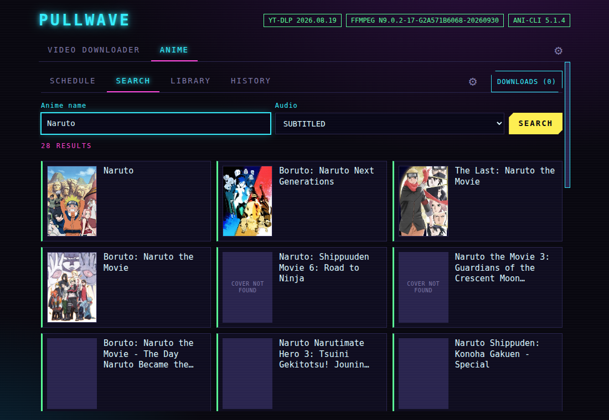

- **Search** an anime, subtitled or dubbed, and click a result to see its episodes.
- **ADD TO LIBRARY** opens a window that explains the **series** (the group the anime belongs to, such as all the seasons of the same show) and the **order** (the place of the season in the series; an order the series already uses is not allowed, and the window says which one is next) and asks you to confirm. It then puts the anime in the library with all its episodes, without downloading anything (once added, the search only says the series). It is then replaced by VIEW IN LIBRARY. Downloads are asked for in the library. The DOWNLOADS button at the top shows how many are running or waiting and opens the list, where each download can be **paused** and resumed. A finished download leaves the list and is announced by a toast; toasts stack, newest on top, and each goes away after 5 seconds.
- **Covers:** every anime in the search, the library, the history and the schedule has its cover, found at AniList by the title (a block that says COVER NOT FOUND shows when there is none). Covers are kept on your computer and checked again the first time each day.
- **Watch without downloading:** click an episode and the player opens.

### Library
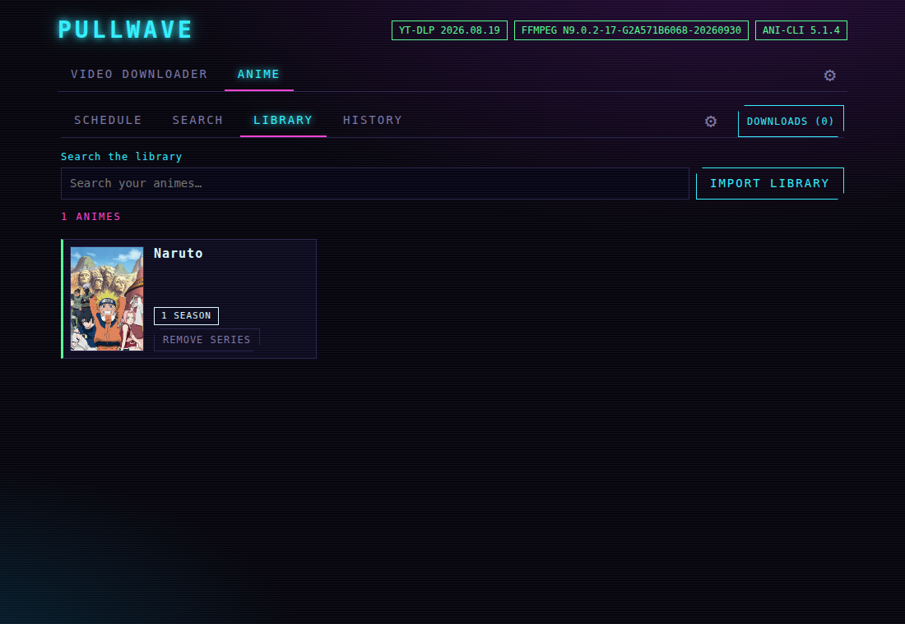

Everything you downloaded, with sizes, where you stopped watching and what failed. Each episode is kept with its subtitles.

- The library shows one card per series. Click it to open the series.
- An episode that is not downloaded shows as NOT DOWNLOADED, with a DOWNLOAD button; on the screen of a series, DOWNLOAD ALL downloads what is missing in every season (and tries again what failed), and each season has its own DOWNLOAD SEASON on its row for the episodes of that season only. OPEN FOLDER is there too.
- The ⚙ at the end of the row of a series has RENAME SERIES (every anime of the series follows, and a season whose order clashes is refused with the next free one) and REMOVE SERIES.
- A paused episode shows as PAUSED, with a RESUME button, and stays paused when the app is closed.
- Search the library by title, open the folder of an anime, and mark episodes as watched (an episode is also marked once you have watched most of it).
- Go from the search to the library, and back, for the same anime (VIEW IN LIBRARY / GO TO SOURCE). The series always opens with every season closed (the one you came for in view when you came from a redirect).
- Removing an anime or a series also deletes its files; an episode cannot be removed alone, and the anime that gives its name to the series is only removed with the whole series.

### Updates
- **UPDATES** lists the episodes that arrived in the library after their anime was in it, the newest first and split by day (today, yesterday, then the date), each with the anime, the episode, the time it was found, how it was found (**AUTOMATIC**: the daily look; **MANUAL**: the button) and whether it is downloaded. Clicking the name opens the anime in the library. **CLEAR LIST** empties the list (it asks first; nothing is removed from the library or from the disk).
- **Looking for new episodes:** once a day (the first time two minutes after the app opens, unless a look was made in the last day: the time of the last one is kept, so opening the app again the same day does not look again) the app asks the source about every anime of the library, one after the other with a pause of about three seconds between them so the source and Cloudflare do not see a burst of requests. **LOOK FOR NEW EPISODES** does it now, whatever the setting says. The first time an anime is looked at its episodes are only put in the library: they are not new. After that, the episodes the source lists that the library lacks are added as not downloaded, the screen says how many and of which anime, and the card of the anime (and the episode) says **NEW EPISODE** for the rest of the day.
- While a look goes on (the daily one or a button) the button **LOOK FOR NEW EPISODES** is off and says how far it is (`AUTOMATIC LOOK… 12/200`), and beside it a line says which anime it is asking about now. The daily look never starts over one that is still going on, however long it takes. The manga section does the same with **LOOK FOR NEW CHAPTERS**, which it still looks for every hour.
- If every anime of a look fails (the source is down or refuses), it is tried again after an hour, then after twice as long each time, up to six hours (a look in which nobody answered does not count as the look of the day); if the source refuses (Cloudflare) the look ends at once. An anime the source does not list any more (or lists twice under its title) is left alone until you open it.
- The place of an anime in the results of its search is checked by its title at each look, so it is found again when a new anime is listed before it.
- Two options in the settings of the anime: **Look for new episodes once a day** (on) and **Download the new episodes found** (off). With the second on, the new episodes are downloaded at once, up to 24 of one anime in one look; if more than 24 arrive at once (the list of the source probably changed) they are all put in the library but none is downloaded by itself.

### Series and seasons
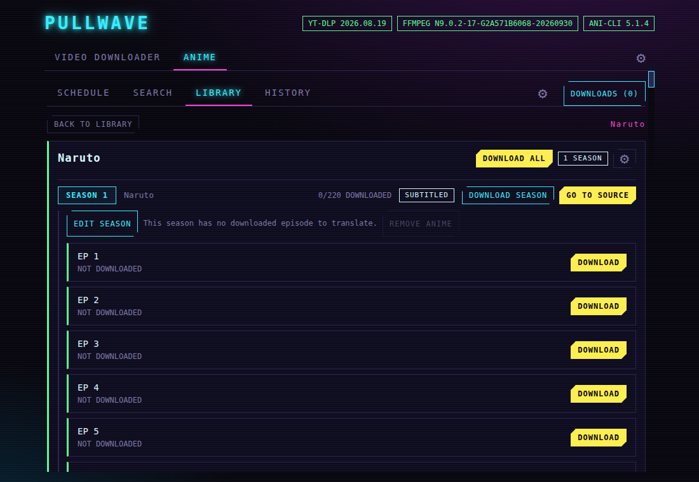

The source lists every season as a separate anime. Give them the same **series** name and an **order**, and they become one series with its seasons in order. The app suggests the names from the title, and you can change them before adding the anime to the library. After that the series cannot change (rename it from its screen); EDIT SEASON changes the order and the name of a season. A season can have a name of its own instead of "SEASON N".

Click a season to show or hide its episodes, and click a downloaded episode to play it. Changing a season does not move files you already have.

### Player
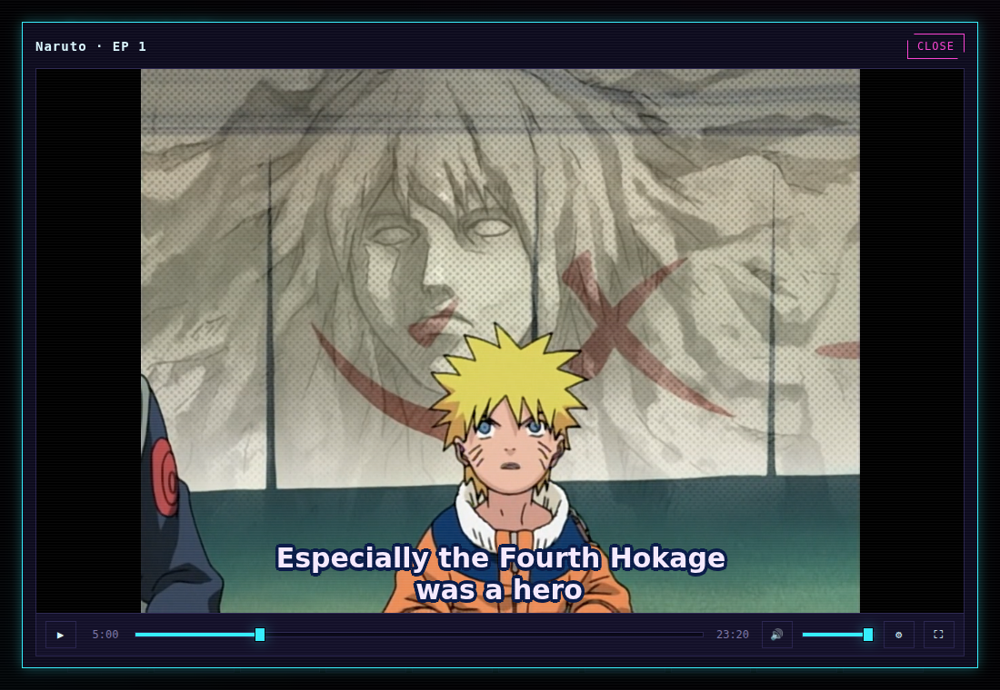

Play and pause, seek (the arrow keys jump 5 seconds), volume, previous and next episode, and a ⚙ with the subtitle settings (which one to show and the size). It remembers where you stopped. Click the video to pause and double-click it for fullscreen; in fullscreen the controls hide when the mouse is still for 3 seconds. In the neon themes (Cyberpunk, Synthwave, Terminal) they float over the video with a glowing progress bar. Escape closes the player.

### Subtitles
- One look for every theme: bold white lettering with a navy outline and no box behind it, like the fansubs.
- Subtitles in the language of the app, or the one you choose in the ⚙ of the ANIME tab, when the source has it. Every language the source offers is saved with the episode and can be picked in the player.
- **Watching without downloading** offers every language the source lists in the ⚙ of the player, with the one that fits the language of the app shown first.
- **CHECK SUBTITLES** looks again for languages the episode does not have yet and adds them.
- Language names appear in the language of the app ("Português (Brasil)").
- **LOAD SUBTITLE** adds your own `.vtt` or `.srt` file to an episode.
- **TRANSLATE SUBTITLE** (in the player) asks a language model to translate a subtitle of the episode into another language and saves it next to the video. **TRANSLATE SUBTITLES** (in the episodes of a season) does it for every downloaded episode of the season, one after the other. See [Translating and creating subtitles](#translating-and-creating-subtitles).
- **CREATE SUBTITLE** (in the player, when the episode has no subtitle at all) writes one from the audio.

### Translating and creating subtitles
These use **your own account** with a provider; the app has no key of its own and nothing is charged by Pullwave. Everything is set in the anime settings (⚙ of the ANIME tab):
- **Subtitle translation:** the provider (ChatGPT/OpenAI, Claude, Gemini, DeepSeek, GLM, Kimi, or any service that speaks the OpenAI protocol, with its address), the model (you write its name), the default language and the token.
- **Subtitle creation (speech to text):** the service (OpenAI's Whisper, Gemini, or another that speaks the OpenAI protocol), the model (`whisper-1` for OpenAI; for Gemini a model of Gemini that takes audio) and its token. The token of the speech service is kept apart from the one of the translation.
- **The tokens** are kept encrypted by your system's keyring, in the main process of the app, and are never shown again. Without a keyring (some Linux setups) the app says so and does not save them.

How it works:
- **Translate:** only the text of the subtitle is sent, in batches; the times never leave the computer. Before it starts, the window shows how many lines and requests it takes and about how many tokens, and nothing is sent until you confirm. The translation is saved as `<video>.translated-<Language>.vtt`.
- **Create:** you choose the **language of the audio** (Japanese by default) and the **language of the subtitle** in the window. The audio (never the video) is taken out of the episode on your computer, cut into parts of ten minutes and sent to the speech service one at a time; the window says how long it is, how many bytes and to which service, and then shows the steps as they happen with the parts sent and the time. Only the subtitle in the language you asked for is saved, as `<video>.generated-<Language>.vtt`.
  - Same language as the audio: it is transcribed.
  - English: OpenAI's Whisper translates the audio into English at once. If the service refuses, the audio is transcribed and the text translated.
  - Another language with Whisper: the audio is transcribed and then the text is translated with your translation provider (two charges).
  - With **Gemini** as the speech service, any language is written at once from the audio, in one step.
- Both can be cancelled. If something fails nothing half-made is saved. The quality depends on the model: transcription can miss names and invent text over music, and the times Gemini gives are by seconds, so they can drift a little.

### History
Lists the anime you opened or watched, the most recent first, with the last episode you watched. OPEN brings it back with its episodes.

### Keeping your library
- **IMPORT LIBRARY** rebuilds the library from a folder, for a new computer, a reinstall, or after you renamed or moved folders. Episodes downloaded by the app come back exactly as they were, with where you stopped watching. An episode whose file is gone is marked.
- **MIGRATE FOLDER** (in the anime settings) moves the whole library to another folder safely, and points the app to it.
- **Status of the programs** (in the ⚙ of the ANIME tab) shows ani-cli, busybox and curl: installed or not, version, and **UPDATE TO** the newest ani-cli when the source changes and something stops working. It downloads the latest version from the ani-cli project, so use it only if you trust that project (it publishes no signature, so what is checked is that the file looks like ani-cli, that the shell accepts it, and that the changes Pullwave makes to it still fit: if the one that finds the stream no longer fits, it is not installed, and if only a subtitle feature does not fit, it is installed and you are told). **USE THE VERSION OF THE APP** goes back to the version the app was made with; busybox and curl stay at it. The programs are downloaded the first time the app opens, so nothing of the anime section works until they are there (a bar shows how it goes, and **TRY AGAIN** appears for any that failed).

### Good to know
The episodes come from an external source that can change or block requests at any time; updating ani-cli often fixes that. Some antivirus programs distrust the small tools ani-cli uses on Windows; they are the official builds (see [`resources/THIRD_PARTY_NOTICES.md`](resources/THIRD_PARTY_NOTICES.md)). Some video formats may not play inside the app. The same disclaimer applies: see [DISCLAIMER.md](DISCLAIMER.md).

## Manga
Read and keep manga from the sites that the extensions of [Mihon/Tachiyomi](https://mihon.app) support, on Linux and Windows (64 bits). The extensions run in [Suwayomi-Server](https://github.com/Suwayomi/Suwayomi-Server), which Pullwave downloads **once, when it opens** (about 330 MB, checked against the checksum of its release) and runs for you in the background, together with [FlareSolverr](https://github.com/FlareSolverr/FlareSolverr), which gets past the check of Cloudflare that some sites have and runs in **Docker** (Pullwave pulls its image once, about 1 GB; without Docker the sites behind Cloudflare do not work, and the section says so, unless you give the address of a FlareSolverr of your own in SETTINGS → MANGA); nothing else is installed. The downloads themselves (the queue, the pages, the CBZ files) are Pullwave's.

- **Filters and reader:** the SEARCH of a source has a FILTERS panel with what the source offers (genres, tags, status, order...), like the WebUI of Suwayomi. A chapter is read with READ, from the source or, when it was downloaded, from its file: single page, vertical scroll or webtoon, left to right or right to left, with the size and the background of your choice, and it comes back to the page you left on.
- **EXTENSIONS:** add a *store* (the address of an `index.min.json`, for instance the [keiyoushi](https://github.com/keiyoushi/extensions) one, which has a button) and install the extensions you want. An extension brings one or more *sources*, the sites that have the manga. Extensions are made by other people: install only the ones you trust.
- **BROWSE:** the sources of the installed extensions, by language (as in the Suwayomi WebUI). Open one on its **popular** or **latest** manga, search it, open a manga and pick chapters. Some sources need to be set up first (a server address, a mirror, a language): the ⚙ on the page of the source.
- **Downloads:** up to three chapters at a time for each site and three sites at once (nine chapters at most), three tries, pause and resume (also after the app is closed and opened again), and a chapter that is cut short goes on from the pages it has. **PAUSE ALL** pauses what is downloading and holds the chapters that wait, which keep waiting until **RESUME ALL**. Each chapter is a **CBZ** (or a folder of images, in the settings) with a `ComicInfo.xml`, in `Pullwave Manga/<manga>/` inside your downloads folder (or the folder you choose).
- **SEARCH:** look for a name in **all the sources of a language at once** (two at a time). Each source says whether it found it, did not, or failed, and a result opens the manga. A title that you already have from another source is marked *in library (other source)*, and adding it again asks first. The last search is kept when you change tabs.

  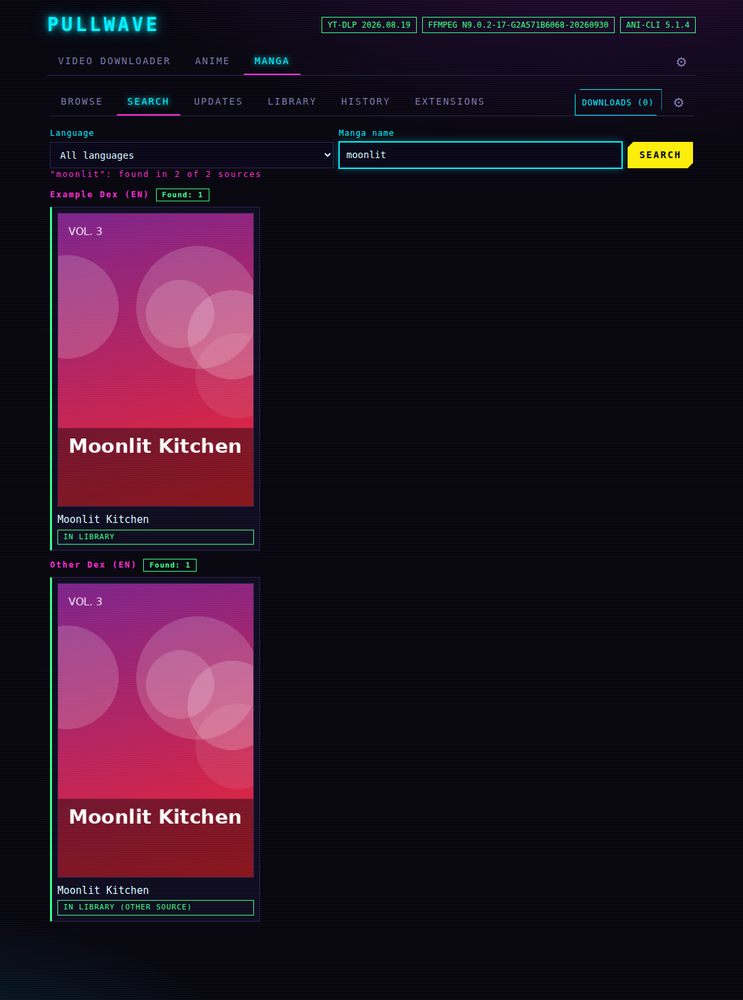
- **LIBRARY:** your mangas as cards, like the anime ones, with how many chapters are downloaded and badges for the seasons of a series, for new chapters and for the **source** each manga comes from (name and language; the page of the manga says it too). When the extension of a source is uninstalled the card says so and the page of the manga has **LINK SOURCE**, which opens the window to move it to a source that works (see below). Inside a manga you download what is missing, read, **open the folder**, look for new chapters, and remove a chapter or the manga with its files. They can be put in groups, which show as tabs, in the order you choose with the arrows (↑ moves a tab to the left, ↓ to the right).

  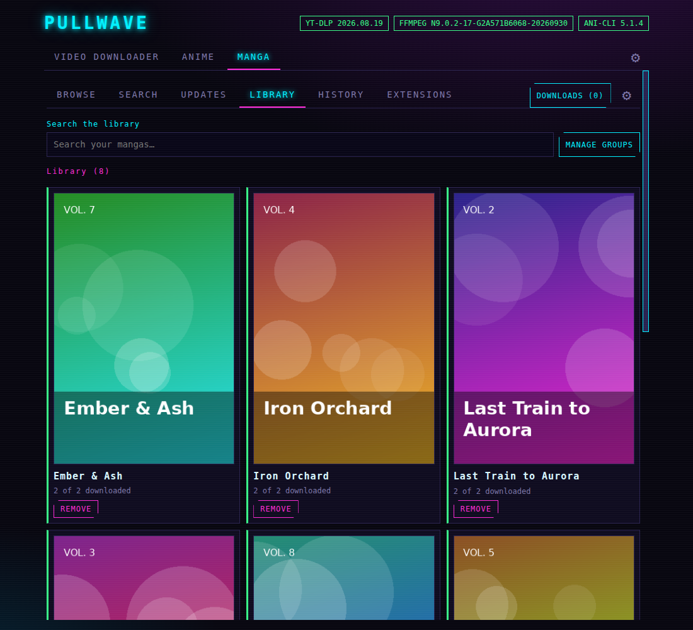
  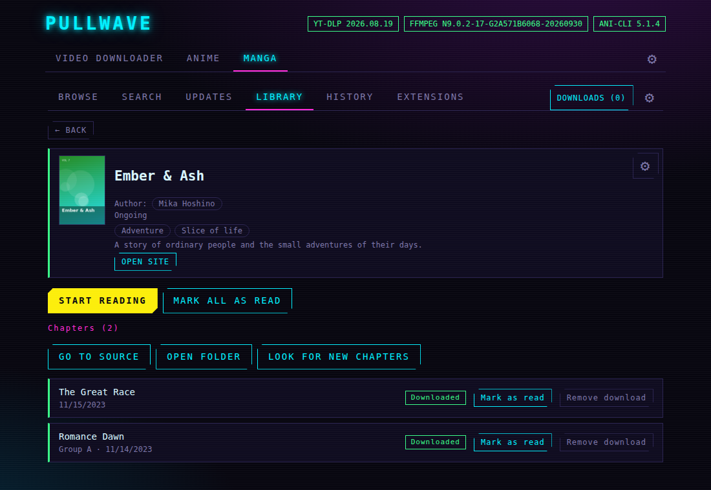
- **MIGRATE TO ANOTHER SOURCE** (in the ⚙ of the page of a manga, or LINK SOURCE) opens a window: pick a **language** to see only the sources in it (the ones that read several languages are always there), pick one source or all of them, search the title, choose the manga and see what happens to the chapters before it is done. What you downloaded stays; the chapters are matched by number.
- **The folder:** as with the anime, once there are mangas in the library the folder is fixed and only **MIGRATE FOLDER** changes it (it moves the files, checks them and then removes the old ones).

  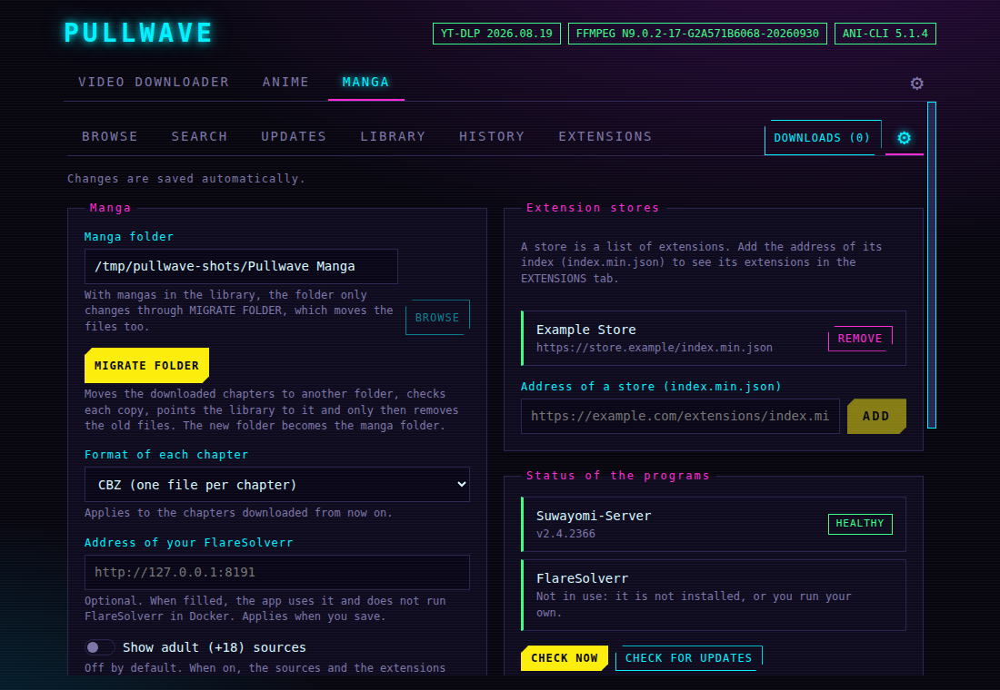

Use it only for content you have the right to download; see [DISCLAIMER.md](DISCLAIMER.md).

## Settings, themes and languages
Settings are saved as you change them. The ⚙ of the top bar has the ones of the whole app:
- **Theme:** Device (follows your system, the default) or one of twelve: the neon ones (Cyberpunk, Synthwave, Terminal in phosphor green) and the flat ones, dark (Dark, Tokyo Night, Nord, Dracula, Gruvbox, AMOLED in pure black, High contrast) or light (Light, Sakura). In the neon themes the controls float over the video in fullscreen with a progress bar that glows in the colors of the theme.
- **Open on:** the tab the app shows when it starts, VIDEO DOWNLOADER (the default) or ANIME (which opens on its schedule).
- **Language:** Device (follows your system, the default), English, Português, Español, 中文 or 日本語. The whole app changes right away.
- **System tray:** keep the app running in the tray when you close the window.
- **App updates:** check for new versions on startup, or now.

The ⚙ of each part has the settings of that part. The app adapts to the size of the window, from a half-screen window up to a 1920x1080 screen.

## Notes
- **System tray on Linux:** it works on KDE, XFCE, Cinnamon, MATE, LXQt and GNOME with an extension. Stock GNOME has no tray: install "AppIndicator and KStatusNotifierItem Support" (Ubuntu ships it enabled; on Fedora `sudo dnf install gnome-shell-extension-appindicator`; on Arch `sudo pacman -S gnome-shell-extension-appindicator`, then enable it). Without one, closing the window quits the app. Right-click the tray icon to restart or quit.
- **Cookies on Windows:** taking cookies from Chrome or Edge can fail because of their newer encryption; Firefox is more reliable.
- **If the app does not start on Linux** because of the system's security settings, run it with `--no-sandbox`.
- The third-party software the app uses (it downloads it the first time it opens) is listed in [`resources/THIRD_PARTY_NOTICES.md`](resources/THIRD_PARTY_NOTICES.md).

## Development
More documentation is in [`docs/`](docs/README.md); how to publish a version is in [`docs/RELEASING.md`](docs/RELEASING.md).

You need Node.js 22 or newer. The app downloads yt-dlp, deno, ffmpeg, ani-cli, busybox and curl itself the first time it opens (they are not in the package); `npm run fetch-binaries` downloads real copies of them for the end-to-end tests.

| Command | What it does |
|---|---|
| `npm run dev` | Start the app in development mode |
| `npm run build` | Build the app into `out/` |
| `npm test` | Unit tests |
| `npm run test:e2e` | Build and run the end-to-end tests on the real app |
| `npm run typecheck` | Type check |
| `npm run lint` | Lint (no warnings allowed) |
| `npm run fetch-binaries` | Download the programs the end-to-end tests run for real (`-- --force` to refresh); they are not shipped |
| `npm run dist` | Linux: build and package the AppImage into `dist/` (never publishes) |
| `npm run dist:win` | Windows: build the installer |
| `npm run release` / `npm run release:win` | Same as `dist` / `dist:win`, then upload to a draft GitHub Release (needs `GH_TOKEN`) |
