<p align="center">
  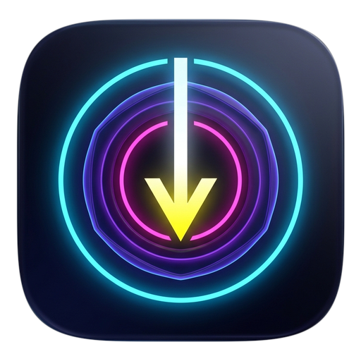
</p>

<h1 align="center">PULLWAVE</h1>

<p align="center">
  <strong>Video downloader, anime library &amp; player, and manga reader for Linux and Windows.</strong><br />
  Console-inspired desktop app with 19 neon &amp; flat themes (Light &amp; Dark) and zero external setup.
</p>

<p align="center">
  <a href="#install">Install</a> ·
  <a href="#getting-around">Getting Around</a> ·
  <a href="#video-downloader">Video Downloader</a> ·
  <a href="#anime">Anime</a> ·
  <a href="#manga">Manga</a> ·
  <a href="#themes-languages--settings">Themes &amp; Settings</a> ·
  <a href="#development">Development</a>
</p>

---

Pullwave brings three workspaces together in a single desktop app:

- **Video downloader:** download videos, audio, playlists, and live streams from any site supported by [yt-dlp](https://github.com/yt-dlp/yt-dlp), with a persistent queue, history, local media explorer, frame-exact media cutter, and batch video-to-audio converter.
- **Anime:** airing schedule, search, local library with series/seasons, automatic update checks, a built-in player, and optional AI subtitle translation and generation — powered by [ani-cli](https://github.com/pystardust/ani-cli) on Linux and Windows 10 (1903)+.
- **Manga:** browse, search, organize, download (CBZ or images), and read manga from [Mihon/Tachiyomi](https://mihon.app) extensions via [Suwayomi-Server](https://github.com/Suwayomi/Suwayomi-Server) on 64-bit Linux and Windows.

> **Disclaimer:** Every download made with Pullwave is **at the user's own risk and responsibility**. The authors and contributors are not responsible for what is downloaded or how it is used. Only download content you have the right to download. See [DISCLAIMER.md](DISCLAIMER.md).

## Themes at a glance

| Neon Tokyo (Light) | Neon Tokyo (Dark) |
|---|---|
| 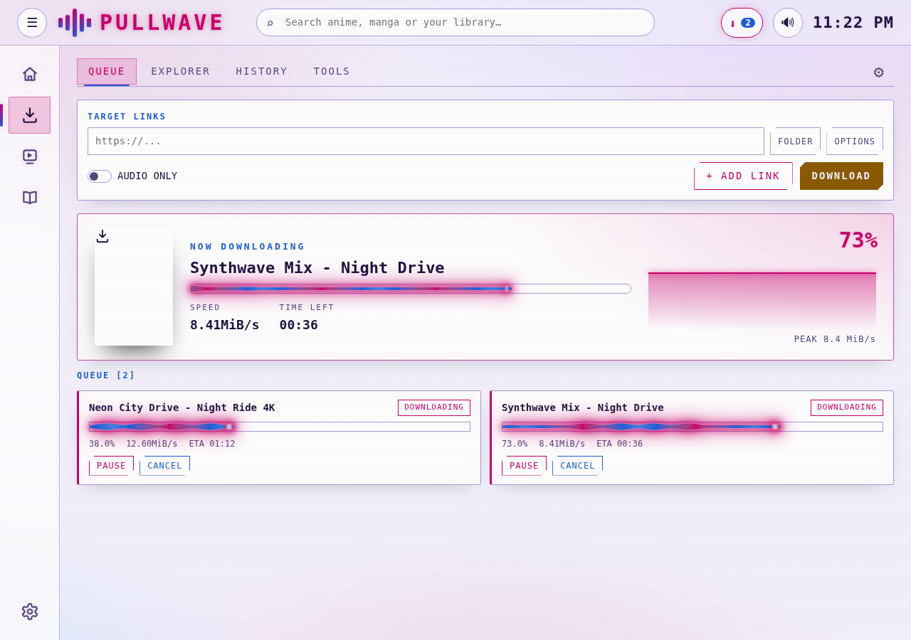 | 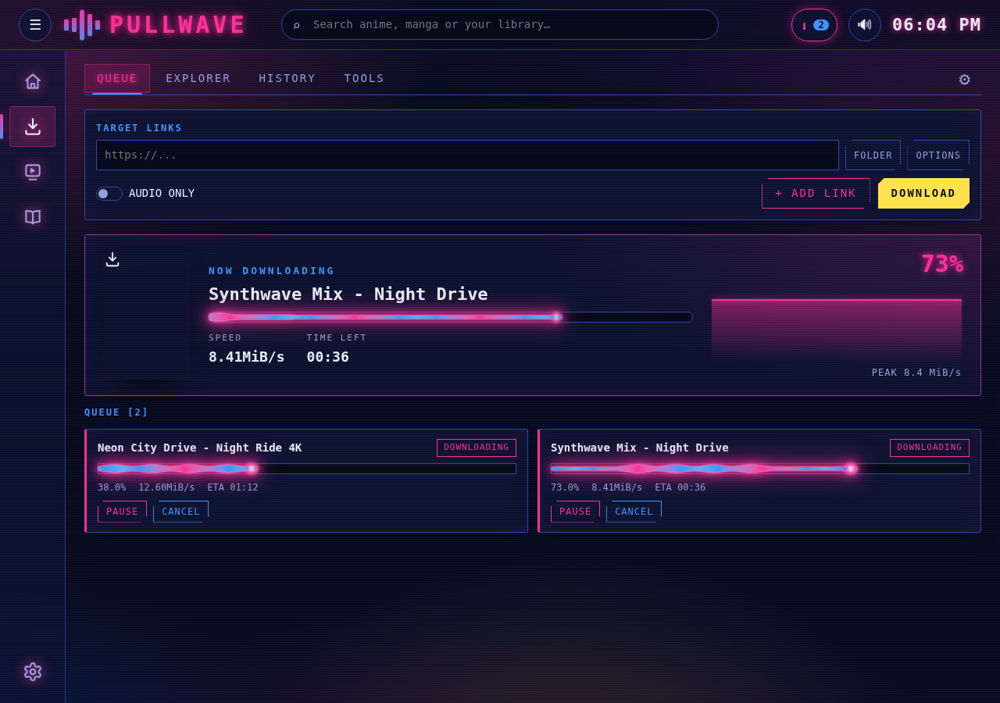 |

| Dark | Light |
|---|---|
| 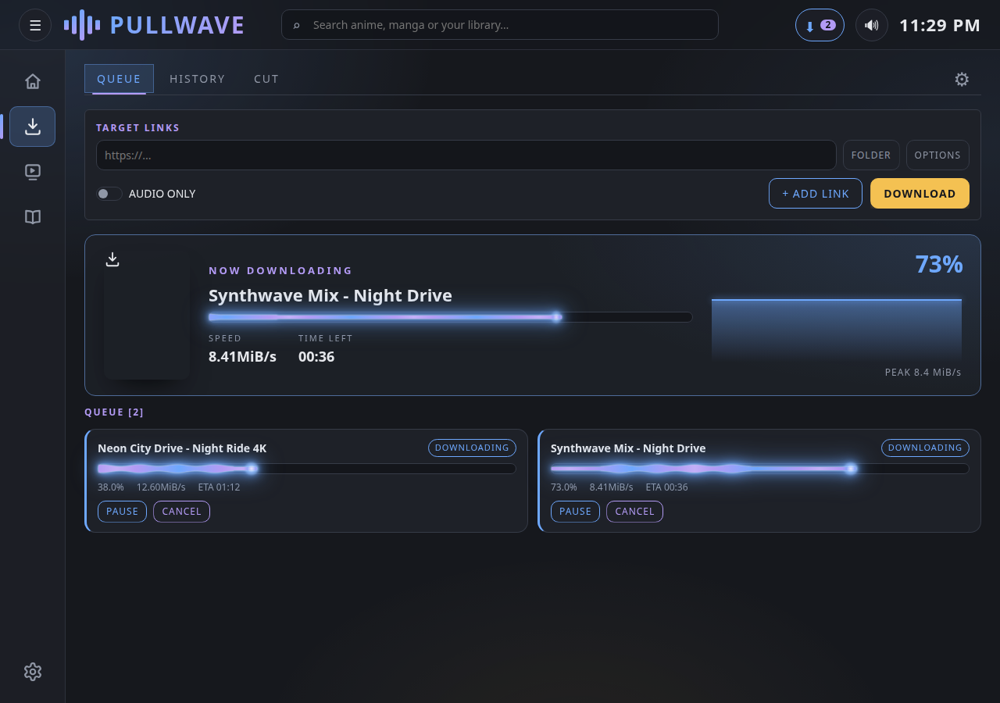 | 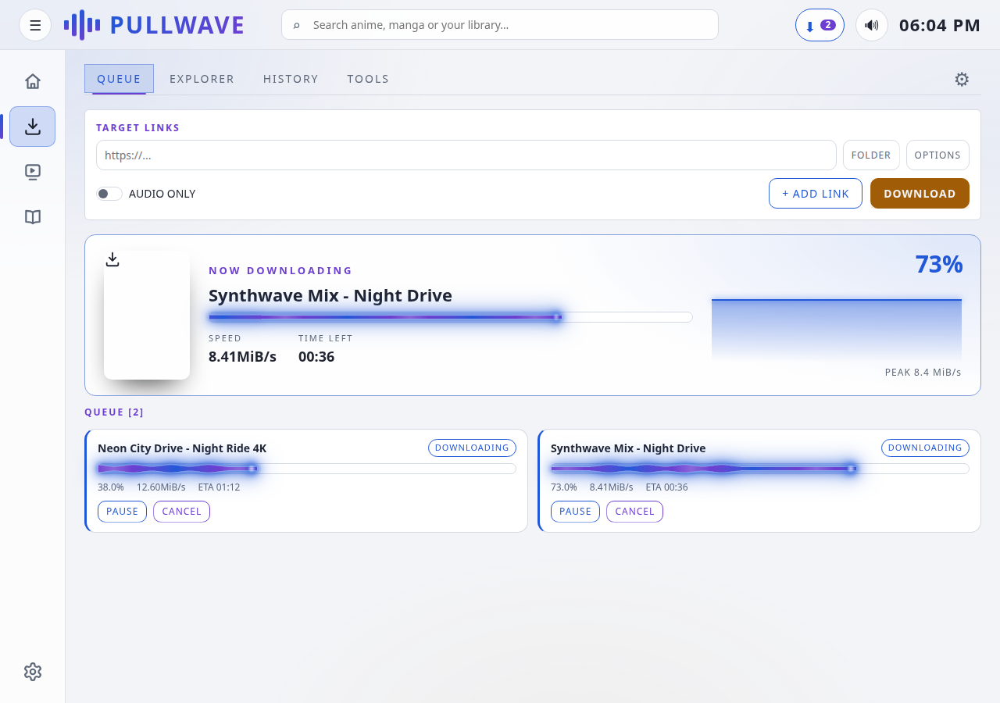 |

## Highlights

- **Flexible video & audio downloads:** pick maximum resolution, container (`mp4`, `mkv`, `webm`), audio-only (`mp3`, `m4a`, `opus`), playlists, subtitles, and browser cookies for authenticated videos.
- **Live-stream recording:** record from the start, wait for scheduled streams, and keep partial recordings safely if the stream drops.
- **Built-in media explorer:** browse local folders filtered strictly to directories, videos, and audio files, with cached FFmpeg video thumbnails, a built-in video/audio player, quick links to Convert, Merge, and Cut, and right-click actions (new folder, rename, show in folder, move to trash with confirmation).
- **Built-in media tools (Cut, Convert & Merge):** extract multiple frame-accurate clips (or audio-only clips) from any local video or audio file with inline preview, batch-convert videos into `mp3`, `m4a`, `opus`, `flac`, or `wav`, or merge multiple videos in custom order with automatic fast-copy / re-encode normalization.
- **Anime library & player:** group seasons into series, track watched status and resume positions, stream without downloading, and watch with fansub-styled subtitles in every available language.
- **AI subtitle tools (BYOK):** translate existing subtitles or generate subtitles directly from episode audio using your own OpenAI, Claude, Gemini, DeepSeek, GLM, Kimi, or custom OpenAI-compatible API key.
- **Full manga workflow:** install Mihon/Tachiyomi extension repositories, search across all installed sources at once, organize with custom groups, download as CBZ with `ComicInfo.xml`, and read in single-page, double-page, vertical scroll, or webtoon modes with auto-scroll.
- **Responsive on every screen:** scales from a half-screen window up to **3440×1440 ultrawide** monitors and **1080×1920 vertical** displays, with keyboard and gamepad navigation.
- **19 theme families & 5 languages:** 11 neon themes and 8 flat themes (each with Light and Dark variants plus System auto-switching), localized in **English, Português, Español, 中文, and 日本語**.
- **Self-contained:** downloads and updates its own bundled tools inside the app directory and checks for Pullwave updates automatically.

---

## Install

Download the latest release for your platform from the [Releases page](https://github.com/monothread/pullwave/releases/latest).

| System | Package |
|---|---|
| Windows 10 / 11 (64-bit) | `pullwave-x.y.z-setup.exe` |
| Linux (64-bit) | `pullwave-x.y.z.AppImage` (portable, no installation required) |

- **Windows:** run the assisted installer wizard. It installs per-user, lets you choose the installation directory, and creates shortcuts. Because the installer is not code-signed, SmartScreen may show *"Windows protected your PC"* — select **More info → Run anyway**.
- **Linux:** make the AppImage executable and launch it:
  ```bash
  chmod +x pullwave-x.y.z.AppImage
  ./pullwave-x.y.z.AppImage
  ```
  Ubuntu 22.04+ requires FUSE 2 (`sudo apt install libfuse2`, or `libfuse2t64` on Ubuntu 24.04). If the app fails to start on Ubuntu 24.04 due to sandboxing, launch it with `--no-sandbox`.

<details>
<summary><strong>First launch &amp; automatic updates</strong></summary>

- **Automatic tool setup:** on first launch, Pullwave downloads its companion tools (`yt-dlp`, `deno`, and `ffmpeg` for Video Downloader; `ani-cli`, `busybox`, and `curl` for Anime — roughly 200 MB total) into its own application directory without modifying your system binaries. Progress chips appear in the top bar (grouped into a single chip such as **3 PROGRAMS** on windows narrower than 1280 px). Failed downloads show the reason and a **TRY AGAIN** button while keeping everything that already succeeded.
- **In-app tool updates:** manage and update tools from **Status of the programs** in Settings (`ffmpeg` in global settings, `yt-dlp`/`deno` in Video Downloader settings, `ani-cli` in Anime settings).
- **App updates:** Pullwave checks for new versions automatically (configurable in global **⚙ → APP UPDATES**). One click downloads the update and another restarts into the new version.

</details>

---

## Getting around

Pullwave is styled and navigated like a console dashboard.

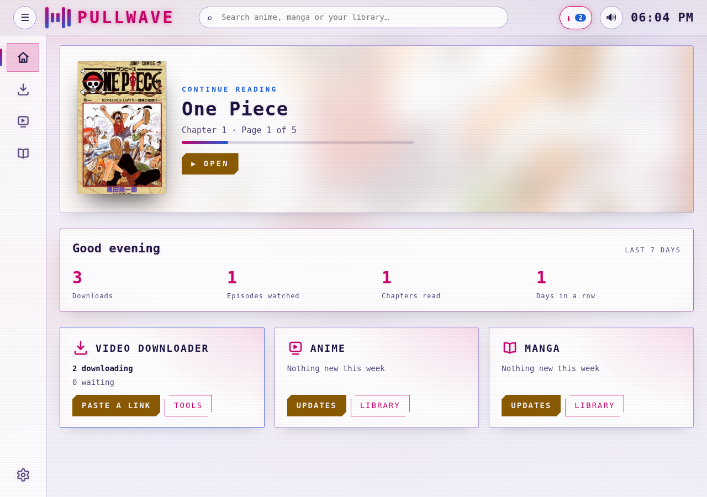

On ultrawide monitors (shown at **3440×1440**), the layout expands, scales cleanly, and switches grids and lists to wider multi-column layouts:

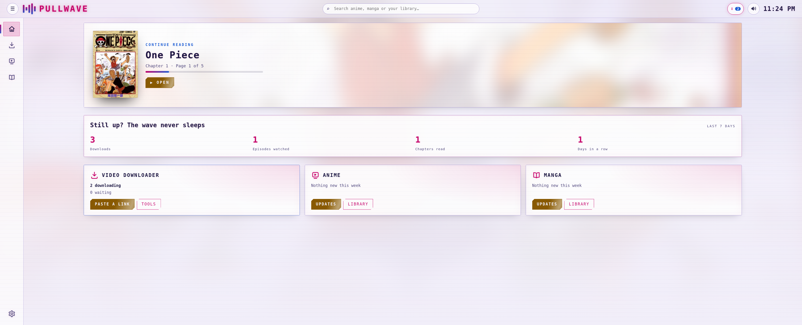

- **Home:** opens with a 5-second spotlight carousel featuring items you are currently watching or reading, followed by anime and manga with new releases in the last 7 days (finished chapters automatically advance to the next unread chapter; up-to-date manga leave the carousel). Below it are live status cards and quick actions for **Video Downloader**, **Anime**, and **Manga**.
- **Navigation rail:** switches between **Home**, **Video Downloader**, **Anime**, **Manga**, and global **⚙ Settings**. Toggle **☰** to expand labels; on narrow windows it collapses into a bottom dock.
- **Top bar:** unified search across your libraries (or directly in Anime/Manga search), a global downloads indicator (**⬇**) tracking active downloads and subtitle jobs (clicking **TRANSLATING** opens the subtitle progress view), a UI sound toggle, and a clock.
- **Libraries:** share the same spotlight carousel, quick filter chips (**ALL**, **NEW** for the last 7 days, plus **ONGOING** and **COMPLETE** in Anime), persistent sort orders (recently added, last watched/read, last episode/chapter added, A–Z, Z–A), and episode/chapter sort toggles. Detail views display full-bleed blurred cover backdrops.
- **Keyboard, mouse & gamepad:** navigate controls with arrow keys (outside text inputs, the player, and the reader), use mouse back/forward buttons for screen history, or use a gamepad (D-pad / left stick to move, **A** to confirm, **B** to go back, **LB** / **RB** to switch sections).

| Section | Tabs |
|---|---|
| **VIDEO DOWNLOADER** | `QUEUE` · `EXPLORER` · `HISTORY` · `TOOLS` · `⚙` |
| **ANIME** | `SCHEDULE` · `UPDATES` · `SEARCH` · `LIBRARY` · `HISTORY` · `DOWNLOADS` · `⚙` |
| **MANGA** | `BROWSE` · `SEARCH` · `UPDATES` · `LIBRARY` · `HISTORY` · `EXTENSIONS` · `DOWNLOADS` · `⚙` |

---

## Video downloader


### Queue & error diagnostics
- Paste one or multiple links (**+ ADD LINK**), override the destination with **FOLDER**, or customize resolution, container, audio-only mode, and live-stream options per link with **OPTIONS**.
- The active download banner displays the video thumbnail (held in memory only while queued), transfer speed with a 1-minute graph, ETA, and separate progress bars for video and audio parts that merge smoothly when post-processing (muxing, metadata, thumbnail embedding) begins.
- Up to **3 downloads** run concurrently. Submitting a link that is already queued, downloading, or paused is rejected cleanly without creating duplicate jobs. **PAUSE** preserves partial files across app restarts; **RESUME** picks up where you left off. Closing the app while downloads are active asks for confirmation and cleans up unfinished files (paused downloads are kept).
- Completed downloads trigger a toast notification, stay highlighted green for 5 seconds, and move to **History**.
- Failed downloads explain the error clearly; clicking **SHOW DETAILS** (or any error message across the app) opens a full diagnostic modal with URL, HTTP status, command, exit code, cause, raw output, and a **COPY** button.

| Error banner in queue | Error details dialog |
|---|---|
| 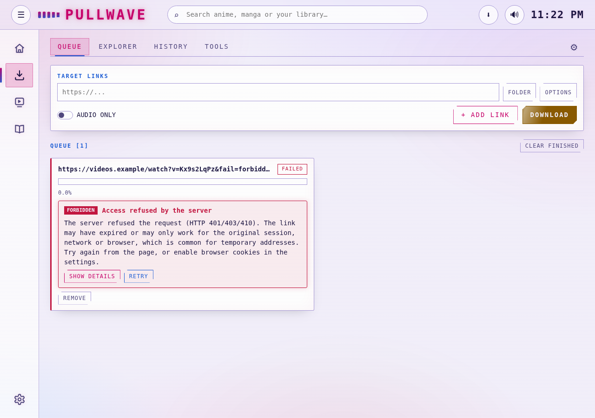 | 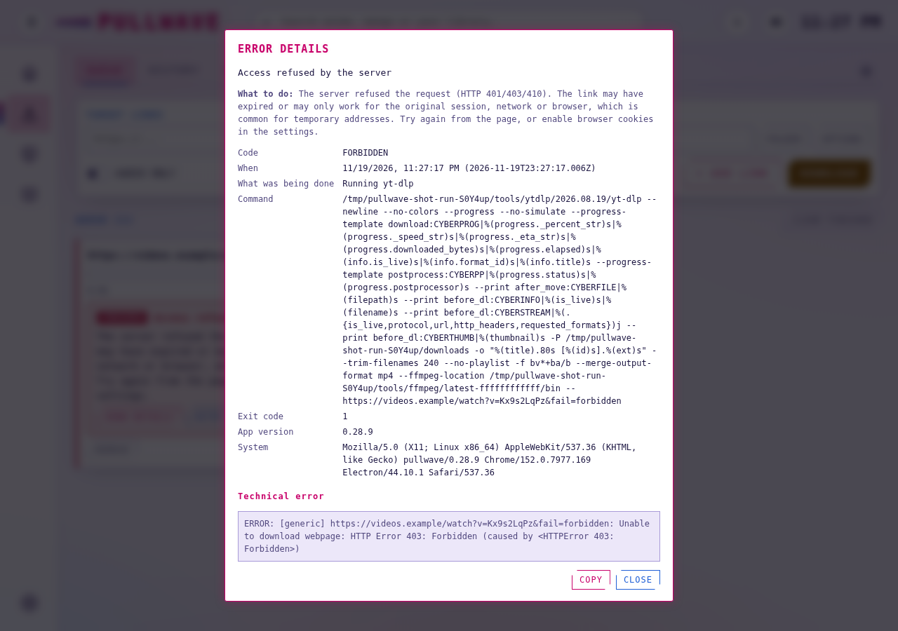 |

### History
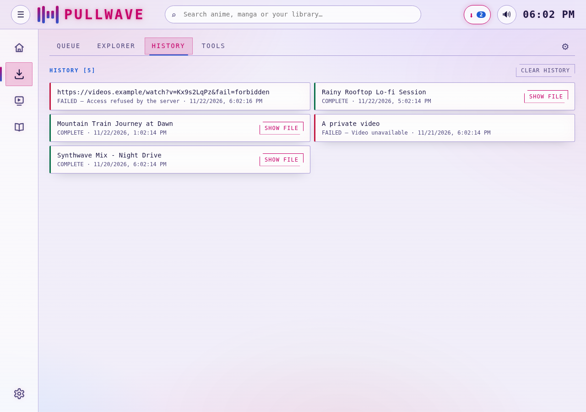

Lists every finished and failed download with timestamp and a quick action to reveal the file in your file manager.

### Explorer
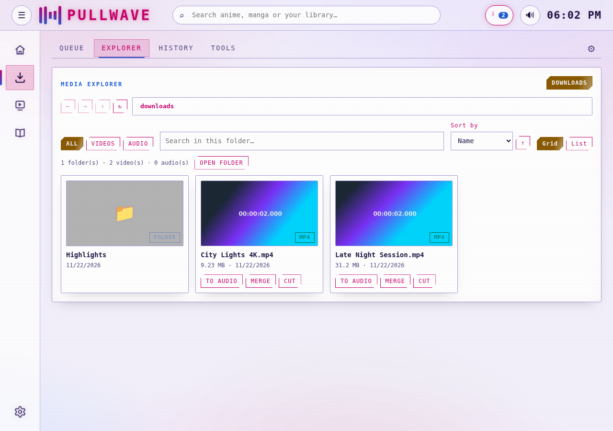

Browse your configured downloads folder directly inside Pullwave:
- Confined to your configured **downloads directory** (and its subfolders) and shows **only folders, videos, and audio files** — non-media files are filtered out automatically, with a persistent **Hidden** toggle for hidden folders and hidden video/audio files (supporting both dotfiles and Windows `FILE_ATTRIBUTE_HIDDEN`), search and type filters (**ALL**, **VIDEOS**, **AUDIO**), persistent sort and view preferences, breadcrumb navigation, **UP**, **REFRESH**, and a single **OPEN FOLDER** button next to the item count summary.
- Video cards load on-demand FFmpeg thumbnails backed by a session disk cache with a 30-minute TTL.
- Click any folder card to enter it, or click any video/audio card to play it inside the built-in media player (with Previous/Next navigation, `VideoControls`, keyboard shortcuts, `Escape`/mouse-back close, and automatic FFmpeg fallback transcoding when a codec is unsupported).
- Media cards include quick **TO AUDIO**, **MERGE**, and **CUT** actions; clicking **SHOW FILE** in the queue, history, converter, or merger reveals and highlights the file directly inside the Explorer tab; right-clicking a card or the background opens a context menu next to the cursor with **New folder**, **Rename** (preserving file extensions), **Show in folder**, **Convert to audio**, **Add to merge**, **Cut**, and **Move to trash** (for media files and completely empty folders, with a confirmation dialog).

### Tools (Cut, Convert & Merge)
| Cut mode | Merge mode |
|---|---|
| 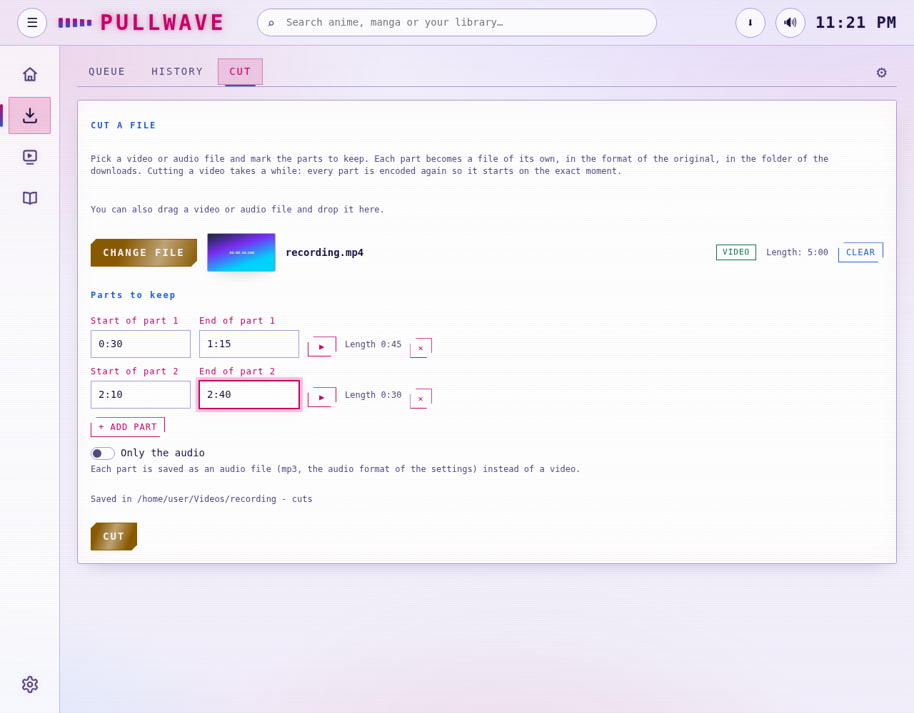 | 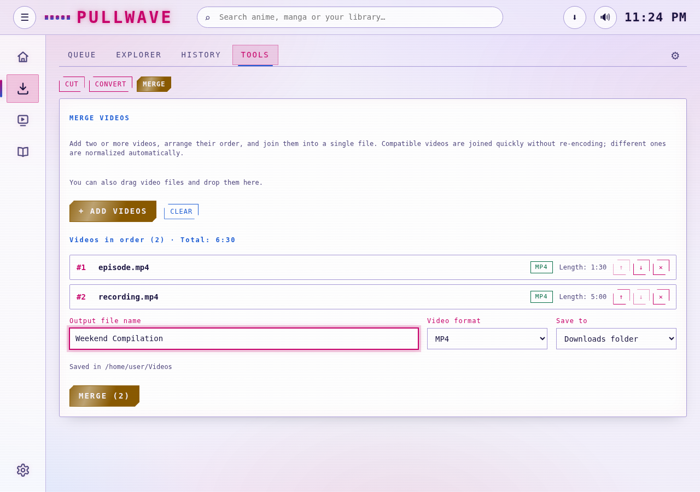 |

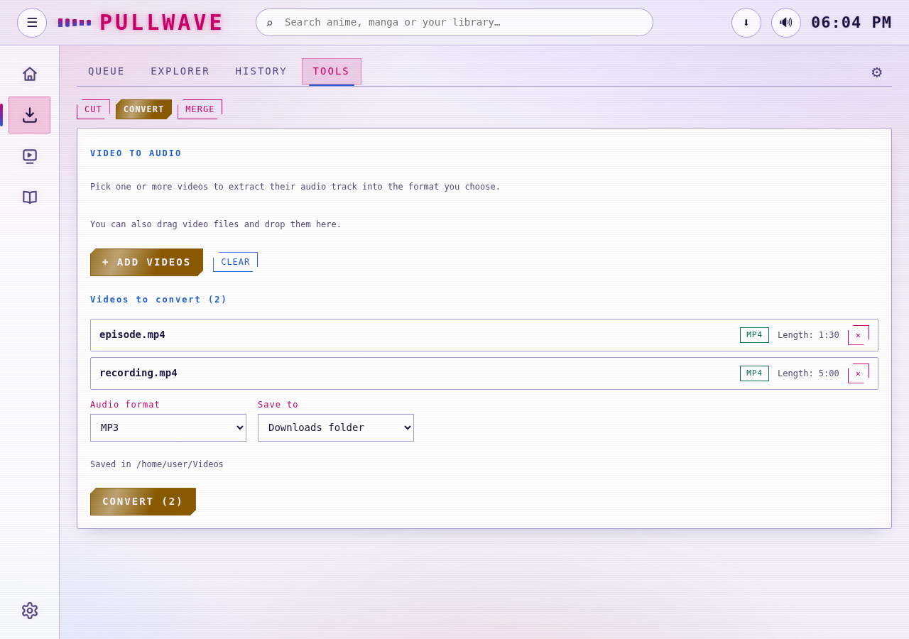

A unified **TOOLS** tab brings **CUT**, **CONVERT**, and **MERGE** together behind a mode switcher (preserving each tool's state and displaying an active indicator if another mode is running in the background):

- **Cut:** click **CHOOSE FILE** or drag and drop a video/audio file to see its thumbnail/cover, media type (**VIDEO** / **AUDIO**), and duration. Add as many start/end ranges as you need (`m:ss`, `h:mm:ss`, or seconds with decimals such as `1:34.5`), preview any segment with **▶**, and export frame-exact clips (or audio-only clips in your preferred audio format) into `<name> - cuts/` inside your downloads folder without overwriting existing files.
- **Convert:** batch-convert one or more videos into **MP3**, **M4A**, **OPUS**, **FLAC**, or **WAV** via **CHOOSE VIDEOS**, drag and drop, or directly from **Explorer**. Choose the destination (**Downloads folder**, **Same folder as the video**, or a **Custom folder**), track per-file progress sequentially at low CPU priority, skip videos without an audio track cleanly, and **CANCEL** mid-batch while keeping completed audio files.
- **Merge:** join two or more local videos (including repeated clips) into a single file. Reorder videos with **↑** / **↓** controls, set an optional output name, container (**MP4**, **MKV**, or **WEBM**), and destination (**Downloads folder**, **Folder of the first video**, or a **Custom folder**). Compatible videos (matching container, codecs, resolution, pixel format, exact fps, timebase, audio specs, and stream order) are merged quickly via lossless stream copy (**FAST COPY**), while mixed or incompatible videos are automatically normalized and re-encoded (**RE-ENCODE**, synthesizing silence when mixing silent and audio clips).

### Quality, cookies, live streams & settings
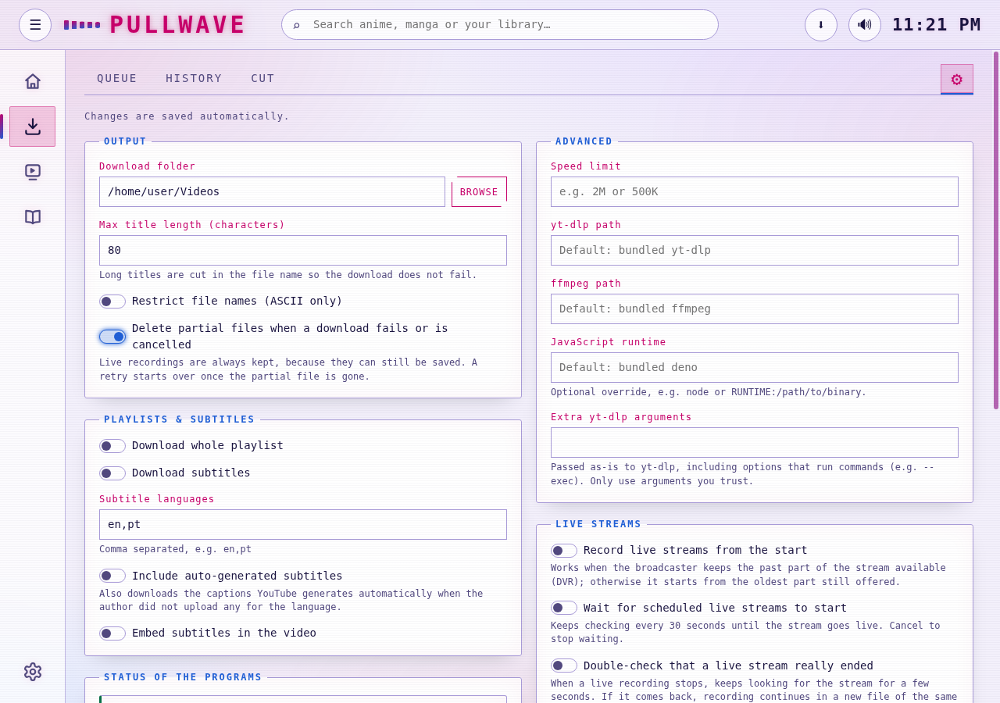

- **Quality & formats:** best video+audio up to your chosen resolution cap (`4K` down to `480p`), container (`mp4`, `mkv`, `webm`), audio-only (`mp3`, `m4a`, `opus`), playlist downloads, subtitle languages (including auto-captions and embedding), filename length limits, and ASCII-safe filenames.
- **Authenticated videos:** automatically detects installed browsers and profiles for cookie-based downloads (**RESCAN BROWSERS** refreshes detection).
- **Live streams:** record from the start (when supported), wait for scheduled streams, stop and save at any time (**STOP & SAVE**), and automatically keep checking briefly if a stream drops — continuing in a new segment file if it comes back.

<details>
<summary><strong>Tool verification &amp; custom binaries</strong></summary>

In **Video Downloader → ⚙ → Status of the programs**, you can inspect installed versions of `yt-dlp` and `deno`, check for updates, and install new releases safely side-by-side (`yt-dlp` release checksums are verified against the project's bundled PGP signing key before activation). **USE THE VERSION OF THE APP** reverts to the pinned release, and custom paths for your own `yt-dlp` or `ffmpeg` are never overwritten by the app.

</details>

---

## Anime

Pullwave ships ready to run with [ani-cli](https://github.com/pystardust/ani-cli) and its supporting utilities, fetching covers from [AniList](https://anilist.co) with [Kitsu](https://kitsu.io) as fallback.

### Schedule
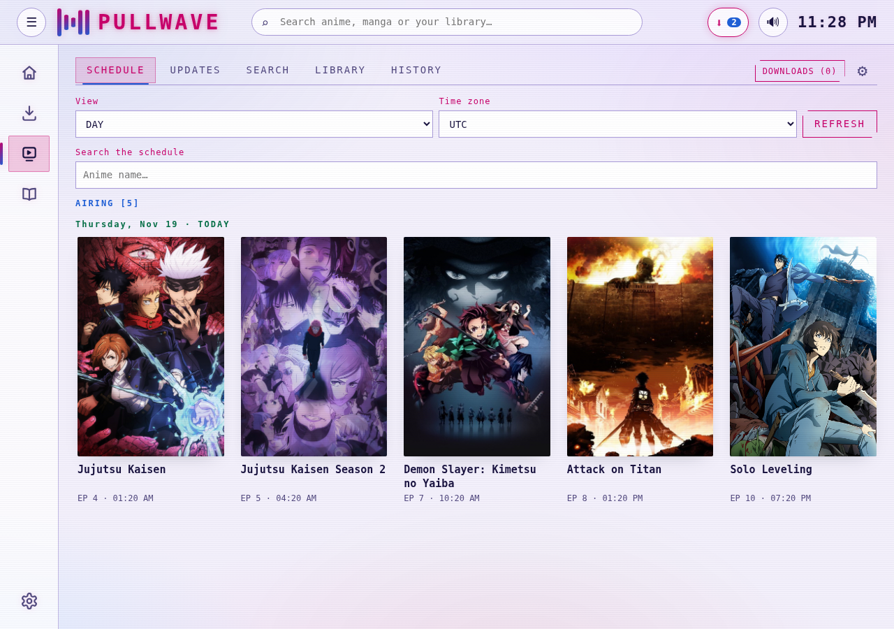

Browse airing episodes from AniList in **DAY** or **WEEK** view, converted to the **Time zone** chosen in global settings and filterable by title or synonyms. Schedule data is cached locally for the day (**REFRESH** forces a fresh fetch), and clicking any card jumps directly to **Search**.

### Search & library

| Search results | Anime library |
|---|---|
| 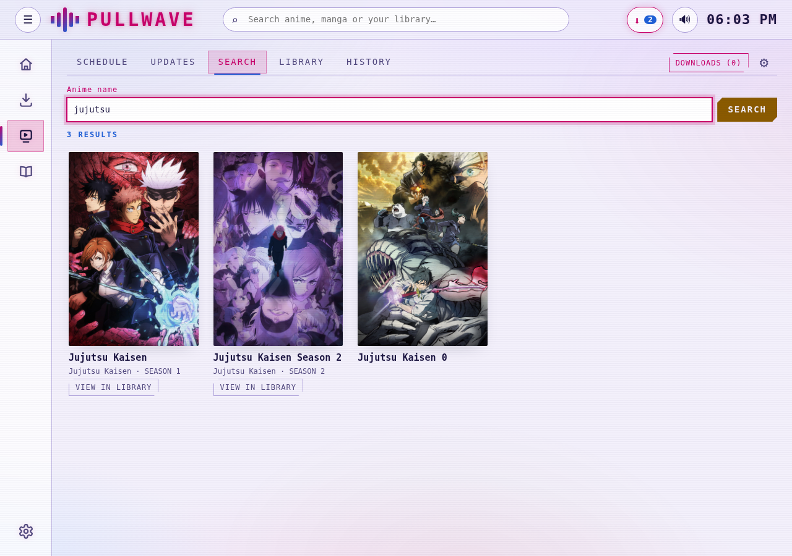 | 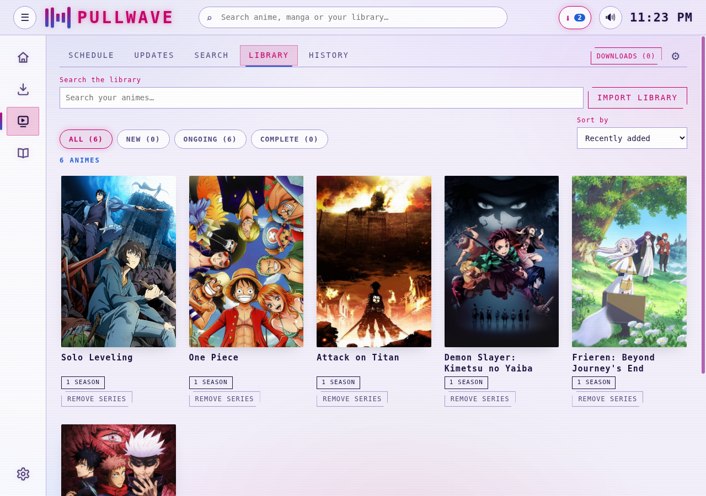 |

- **Search:** search subtitled anime with infinite-scroll pagination (up to 120 results). Click any episode to **stream without downloading**, or click **ADD TO LIBRARY** to assign a series name and season order without starting downloads immediately.
- **Library:** groups seasons under one series card, tracks downloaded sizes, missing/silent files, and resume positions, and links seamlessly between search results and library entries (**VIEW IN LIBRARY** / **GO TO SOURCE**).

### Series, seasons & episodes

| Series overview with seasons | Episode cards (watched vs. unwatched) |
|---|---|
| 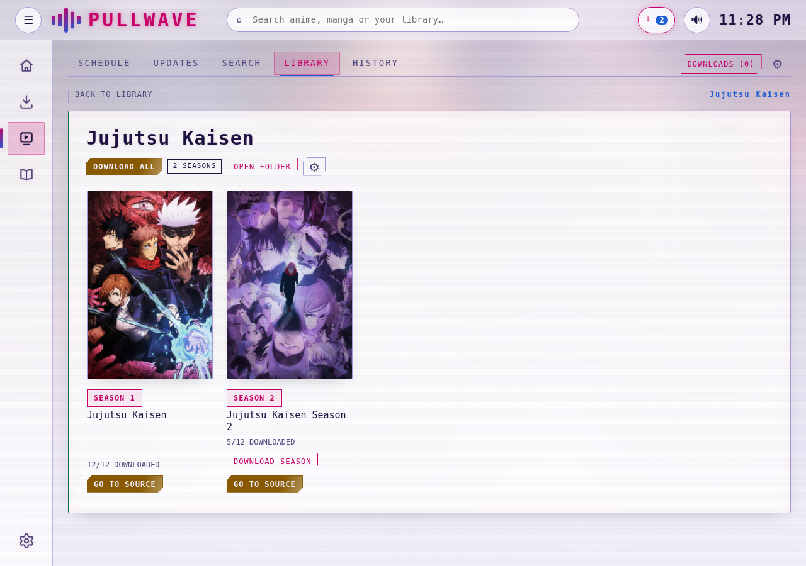 | 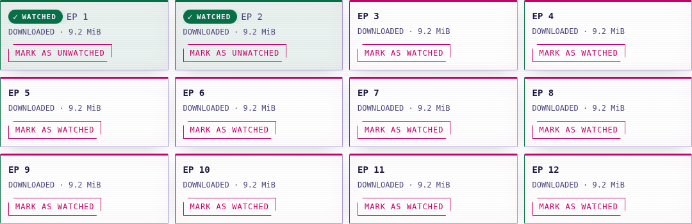 |

- Group multiple seasons under a single series with custom order numbers and optional season names (**EDIT SEASON** / **RENAME SERIES**).
- Each season offers **CONTINUE WATCHING** to jump right back into your next episode or saved timestamp, plus **DOWNLOAD SEASON** and series-wide **DOWNLOAD ALL**.
- Episode cards clearly distinguish watched episodes (green **WATCHED** badge and dimmed card) from unwatched ones.

### Player & subtitles
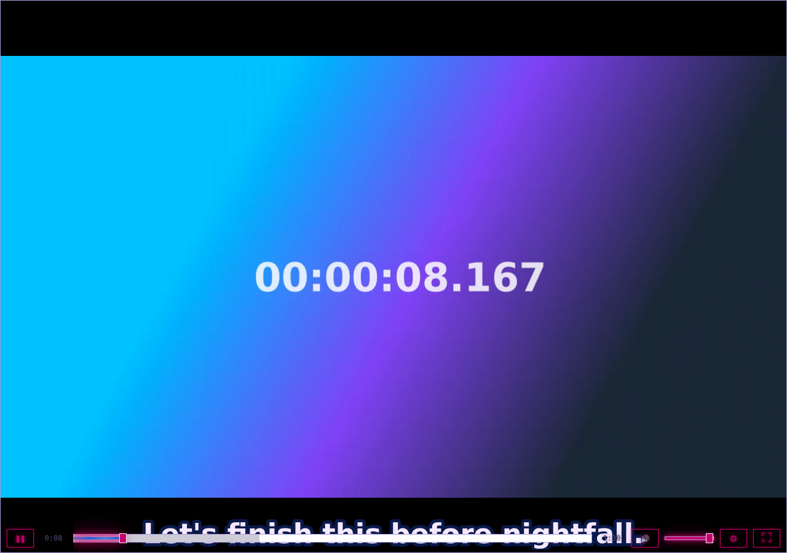

- **Player:** floating controls over the video (auto-hide after 3 seconds in fullscreen), click to pause, double-click for fullscreen, `←`/`→` 5-second seek, `Escape` to close, automatic progress saving, and a 10-second **Next episode automatically** countdown panel (toggleable in player **⚙**).
- **Subtitles:** fansub-style bold white text with dark outline across all themes. Every subtitle track offered by the source is saved alongside downloaded episodes and selectable by localized language/region/type (e.g., *Português (Brasil) · SDH*).
- **Subtitle management (⚙ → MANAGE SUBTITLES):** re-check the source for newly added subtitle tracks (**CHECK SUBTITLES**), load your own `.vtt`/`.srt` file (**LOAD SUBTITLE**), translate a track (**TRANSLATE SUBTITLE**), delete a translated track (**DELETE**, with confirmation), or generate subtitles from audio (**CREATE SUBTITLE**). You can also batch-translate all missing subtitles for a downloaded season directly from the season screen.

<details>
<summary><strong>Automatic episode checks, AI subtitles, library maintenance &amp; tool updates</strong></summary>

- **Automatic update checks:** checks ongoing series in your library every **3 hours** (starting 2 minutes after launch if 3 hours have passed since the last check) and logs arrivals in **UPDATES** with a **NEW EPISODE** badge for the rest of the day. Series marked finished/cancelled on AniList are flagged **COMPLETE** and skipped (overridable per season via **Releases**: Automatic / Complete / Ongoing). Optional settings in Anime → **⚙** automatically download new episodes (capped at 24 per series per check as a safety guard) and translate downloaded episodes in the background.
- **AI subtitle translation (BYOK):** supports **OpenAI**, **Claude**, **Gemini**, **DeepSeek**, **GLM**, **Kimi**, or any **OpenAI-compatible** endpoint using your own API key (encrypted in the OS keyring). Only dialogue lines are sent — timestamps stay local — with an upfront estimate of lines, requests, and approximate tokens before anything is sent, and automatic best-effort series context from AniList (title, cleaned synopsis, and main characters, cached per session) for consistent names and terminology. Saved as `<video>.translated-<Language>.vtt`.
- **AI subtitle generation (speech-to-text, BYOK):** extracts audio locally via `ffmpeg` and saves `<video>.generated-<Language>.vtt`:
  - **OpenAI (`gpt-transcribe`):** splits audio at detected speech pauses and transcribes each piece with series title and previous-line context, then translates via your translation model (enriched with best-effort AniList series context) when a different output language is chosen.
  - **Gemini:** splits audio into **3-minute parts**, requests structured JSON `"MM:SS.mmm"` timestamps and dialogue directly in the target language in one step with rolling previous-line continuity and best-effort AniList series context, and retries malformed responses or HTTP 503 automatically.
  - **Custom OpenAI-compatible service:** splits audio into **10-minute parts** using models that return WebVTT timestamps (such as `whisper-1`), translating via your translation provider when needed.
- **Library tools:** **IMPORT LIBRARY** rebuilds your database from an existing folder; **CHECK DOWNLOADED EPISODES** detects missing files or silent (`NO AUDIO`) videos and offers one-click re-download; **MIGRATE FOLDER** safely moves your entire anime library to a new directory; **Disk space** displays an interactive breakdown ring comparing anime, manga, other files, and free space.
- **Safe `ani-cli` updates:** **Status of the programs** in Anime settings validates any upstream `ani-cli` update (compatibility checks, shell syntax check, and a live search/episode/stream probe) before activating it, with one-click rollback via **USE THE VERSION OF THE APP**.

</details>

---

## Manga

Read and collect manga from [Mihon/Tachiyomi](https://mihon.app) extensions on 64-bit Linux and Windows. Pullwave downloads and manages [Suwayomi-Server](https://github.com/Suwayomi/Suwayomi-Server) automatically (~330 MB, verified by release checksum), while handling queues, CBZ packaging, library management, and reading natively.

### Browse, extensions & multi-source search
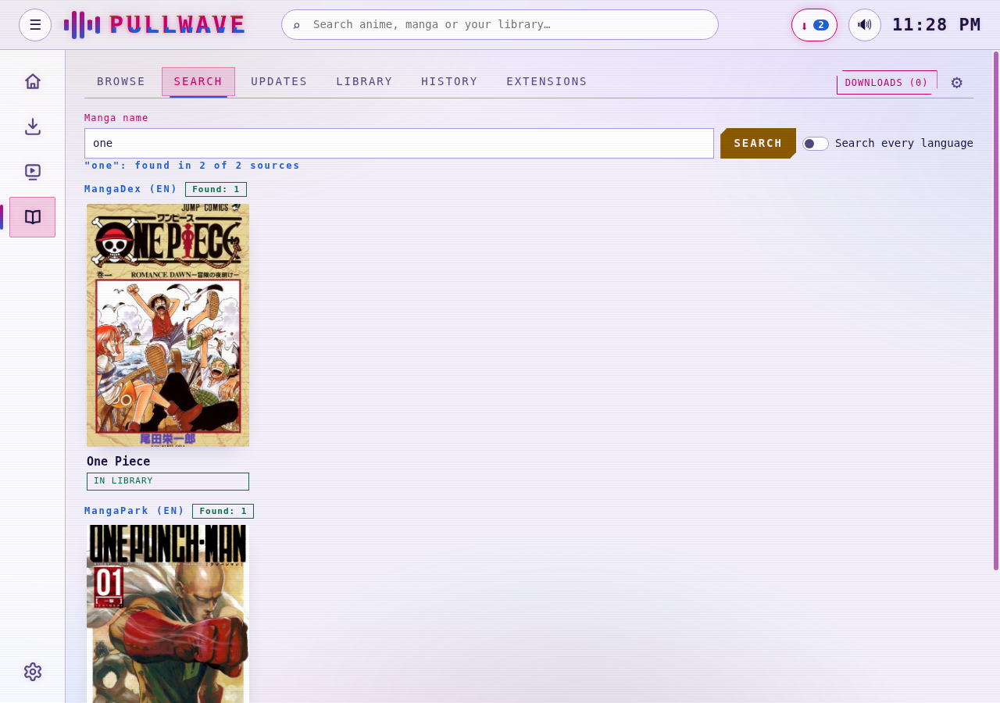

- **Extensions:** add any extension repository (`index.min.json`, with a quick button for [keiyoushi](https://github.com/keiyoushi/extensions)) and install the sources you trust. Each installed extension shows how many of your library manga come from it; click the number to see their cards and jump to any of them in the library.
- **Browse:** explore each source's **Popular** and **Latest** catalogs with source-specific **FILTERS** (genres, tags, status, sort order) and per-source **⚙** preferences.
- **Global Search:** search across all installed sources in your configured manga language at once (or toggle **Search every language**). Titles already saved from another source are labeled accordingly.
- **Cloudflare support (optional):** enable [FlareSolverr](https://github.com/FlareSolverr/FlareSolverr) in **Manga → ⚙** via one-click **Docker** install or by pointing Pullwave to your own FlareSolverr URL.

### Library & manga details

| Manga library | Manga detail page |
|---|---|
| 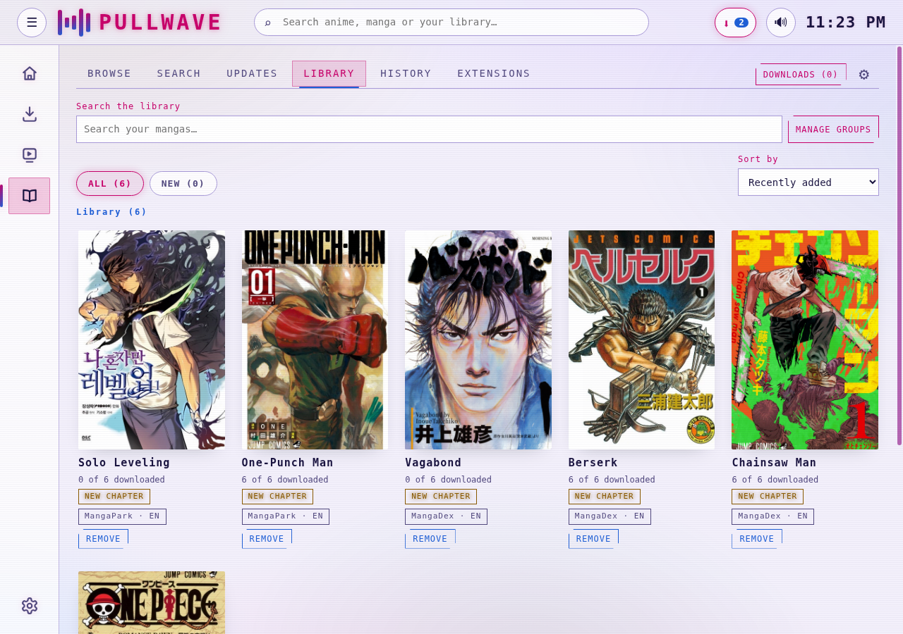 | 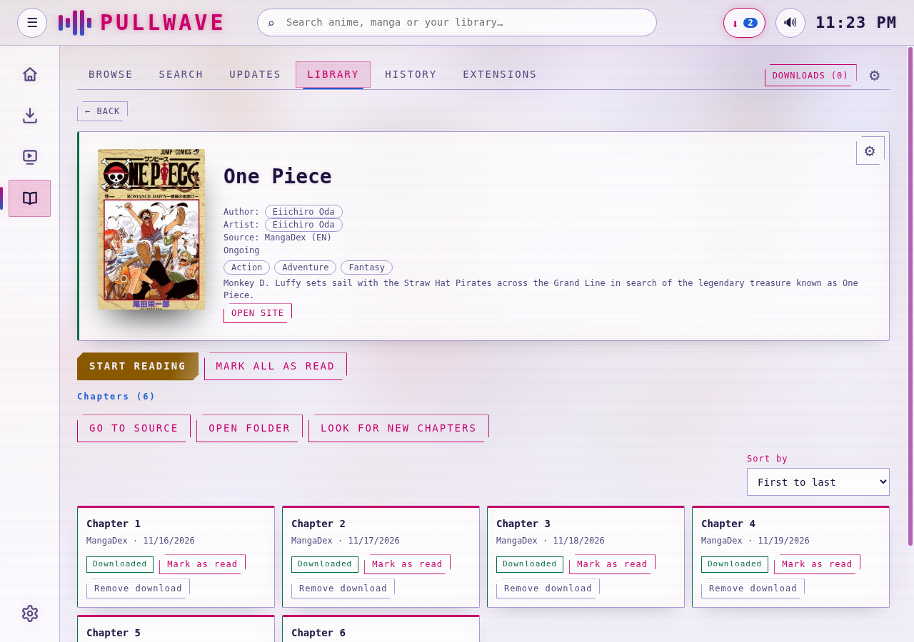 |

- Organize titles into custom **groups** (displayed as reorderable tabs), see downloaded chapter counts, source/language tags, and new chapter badges at a glance.
- Inside a manga page, start or continue reading, download missing chapters, open the local folder, check for new chapters, or migrate the manga to another source (**MIGRATE TO ANOTHER SOURCE** / **LINK SOURCE**) while preserving downloaded files and read marks matched by chapter number.
- **Automatic hourly checks:** scans ongoing manga every hour for new chapters and lists them under **UPDATES** (with optional auto-download).

### Reader

| Manga reader | Two pages side by side |
|---|---|
| 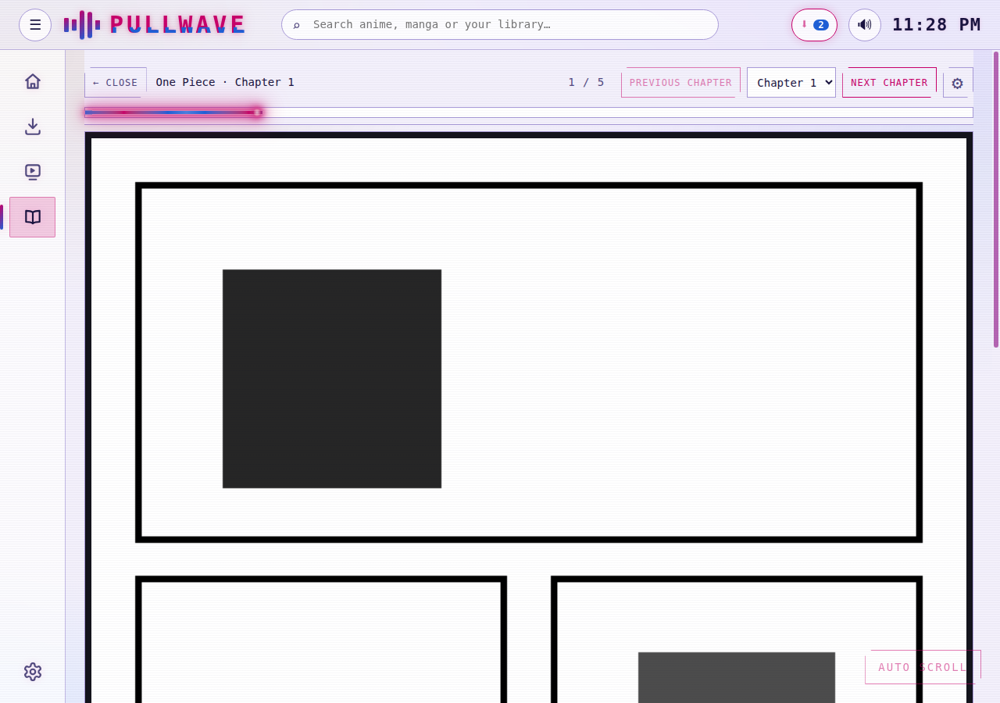 | 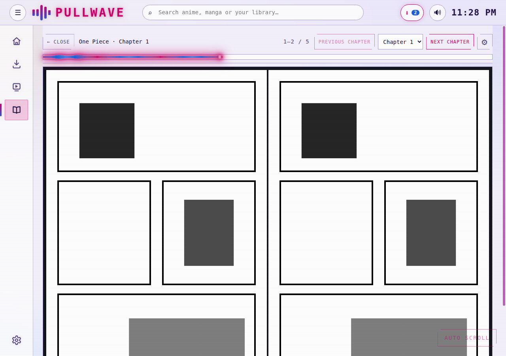 |

- **Reading modes:** **Single page**, **Two pages side by side**, **Vertical scroll**, and **Webtoon** (centered 938 px strip on landscape monitors, full width in fullscreen on vertical monitors), with **LTR** or **RTL** reading direction, custom zoom/fit, background color, and configurable **page gap**.
- **Auto-scroll:** smooth hands-free scrolling in vertical scroll and webtoon modes with configurable speed (**10–600 px/s**) and optional **automatic chapter switching**.
- **Per-manga memory:** each title remembers its own reader preferences and exact reading position — even preserving your exact spot in vertical scroll and webtoon modes when toggling fullscreen (double-click or `Escape`) or resizing the window. The next 3 pages preload ahead for instant page turns.

### Downloads & manga settings
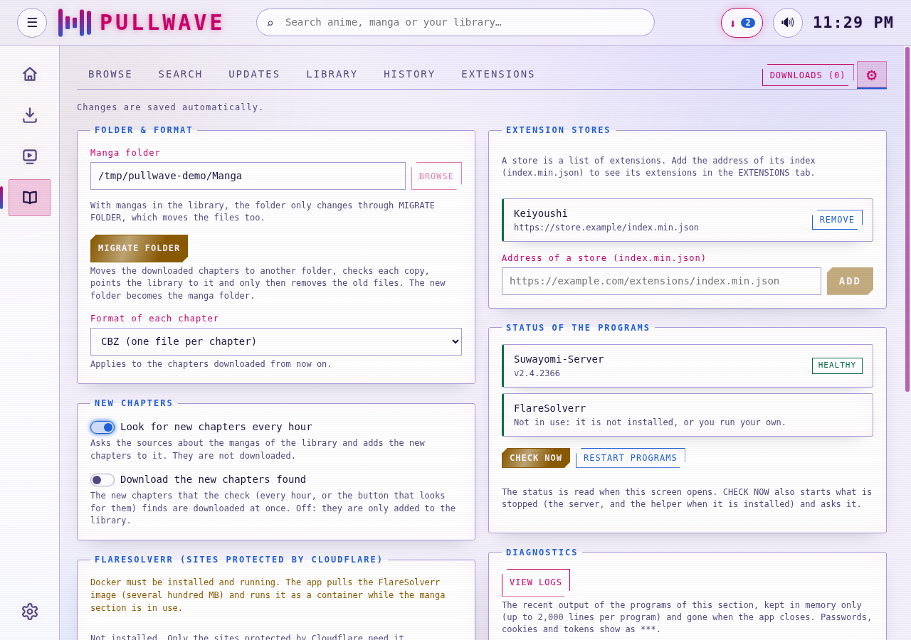

- **Fast, resilient downloads:** up to **3 concurrent chapters per source** across **3 sources at once** (9 total), automatic retries, per-chapter and global **PAUSE ALL / RESUME ALL**, resume across restarts, and speed graphs.
- **Clean archive format & library import:** saves chapters as **CBZ** (with `ComicInfo.xml` metadata) or loose image folders inside `Pullwave Manga/<manga>/` alongside `pullwave.json` metadata; **IMPORT LIBRARY** in the Manga Library scans folders inside your manga directory to rebuild or relink your library offline (reading `pullwave.json`, falling back to `ComicInfo.xml` or folder/file names).
- **Safe folder migration & disk ring:** once titles are in your library, **MIGRATE FOLDER** copies, verifies, and switches your manga folder safely; **Disk space** shows live usage alongside your anime library.

---

## Themes, languages & settings

All settings save automatically. Open global **⚙ Settings** from the navigation rail to configure:

- **Mode & Theme:** choose **System** (follows OS light/dark preference live), **Dark**, or **Light**, paired with **19 theme families** — each crafted in both Light and Dark versions:
  - **Neon (11):** Cyberpunk, Synthwave, Terminal, Neon Tokyo, Acid Rain, Amber City, Ultraviolet, Ultramagenta, Pink Noir, Cyber Gold, Ice Neon.
  - **Flat (8):** Default, Tokyo Night, Nord, Dracula, Gruvbox, AMOLED, High Contrast, Sakura.
- **Language:** Device (auto-detected), **English**, **Português**, **Español**, **中文**, or **日本語** — switches instantaneously.
- **Time zone:** **Device (follows the system)** or any IANA time zone — applies across every displayed date and time in the app (top bar clock, home greeting and streak, anime schedule, download/anime/manga histories and updates, media explorer dates, chapter dates and "New" badges, error details, and diagnostic logs).
- **Audio & desktop integration:** adjustable UI sound volume, **System tray** (minimize to tray on close), **Start with the computer** (with optional start minimized to tray), and **App updates**.
- **Diagnostics:** global and per-section settings include **VIEW LOGS** for live, color-coded, filterable output from `ffmpeg`, `yt-dlp`, `ani-cli`, `Suwayomi-Server`, and `FlareSolverr`. Logs are kept strictly in memory (up to **2,000 lines** per tool), cleared on exit, and automatically redact passwords, cookies, and API tokens as `***`.

---

## Platform notes

- **Linux system tray:** supported out of the box on KDE, XFCE, Cinnamon, MATE, LXQt, and Ubuntu GNOME. On stock GNOME (Fedora/Arch), install the *AppIndicator and KStatusNotifierItem Support* extension (`sudo dnf install gnome-shell-extension-appindicator` / `sudo pacman -S gnome-shell-extension-appindicator`). Without tray support, closing the window quits the app.
- **Windows browser cookies:** newer Chrome/Edge cookie encryption can prevent `yt-dlp` from reading cookies directly; Firefox is the most reliable option on Windows.
- **Linux sandbox flag:** if the AppImage does not launch due to kernel/AppArmor user-namespace restrictions, run it with `--no-sandbox`.
- **Third-party software:** see [`resources/THIRD_PARTY_NOTICES.md`](resources/THIRD_PARTY_NOTICES.md).

---

## Development

Further technical documentation lives in [`docs/`](docs/README.md), and release instructions are in [`docs/RELEASING.md`](docs/RELEASING.md).

Requires **Node.js 26+**. Companion binaries are downloaded by the app at runtime rather than bundled in the repository; run `npm run fetch-binaries` to fetch real copies for local end-to-end tests.

| Command | Description |
|---|---|
| `npm run dev` | Start Pullwave in development mode |
| `npm run build` | Build main, preload, and renderer bundles into `out/` |
| `npm test` | Run unit tests (Vitest) |
| `npm run test:e2e` | Build and run end-to-end tests on the real Electron app |
| `npm run test:e2e:full` | Run the full end-to-end test suite including `@full` tests |
| `npm run typecheck` | Run TypeScript type checking (`tsc --noEmit`) |
| `npm run lint` | Run ESLint with zero warnings allowed |
| `npm run fetch-binaries` | Download companion binaries for E2E tests (`-- --force` to refresh) |
| `npm run screenshots` | Build and regenerate README screenshots via Playwright |
| `npm run dist` | Package Linux AppImage into `dist/` (does not publish) |
| `npm run dist:win` | Package Windows NSIS installer into `dist/` (does not publish) |
| `npm run release` / `npm run release:win` | Package and upload to a draft GitHub Release (requires `GH_TOKEN`) |
